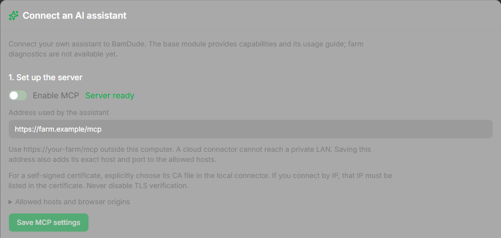

# Connect an assistant

Check the [development status and support matrix](clients.md) first. These steps require a build containing the MCP setup panel and matching packages.

## 1. Open the setup panel

In BamDude, open **Settings → API Keys → Connect an AI assistant**. You need permission to read settings. Saving server configuration needs settings-update permission; creating or checking keys needs the corresponding key-management permissions. If a control is unavailable, ask your administrator rather than borrowing an administrator key.



*Development preview with test data; no live farm or real key is shown.*

## 2. Save the server address

Enable MCP and enter the exact address the **client** will use, for example `https://farm.example/mcp`. Click **Save MCP settings**. Saving also adds that address's exact host and port to the allowed hosts. The panel never derives a public address from the browser's request headers.

Use HTTP only when the connector runs on the same computer as BamDude: `http://127.0.0.1:8000/mcp`. On a different computer, use HTTPS. `localhost` refers to the computer making the request, not automatically the farm server.

Under **Allowed hosts and browser origins**, add other exact hosts and ports only when needed. Browser origins are usually empty for local clients; if a client sends one, add its exact `https://host:port` origin. Do not use wildcards or the origin `null`.

For a self-signed LAN certificate, the local connector accepts an explicit PEM **CA file**. The certificate must match the address: an IP connection requires that IP in its subject alternative names. Never disable TLS verification. See [certificate troubleshooting](troubleshooting.md).

## 3. Choose and install the client package

Choose your client and follow its [client instructions](clients.md). **Download client package** is available only when this build contains a package matching the server version, contracts and canonical skill. **Download skill** remains a separate option.

Do not rename a ZIP to MCPB or assume a package works in every client. Claude Desktop needs both its connector and a separate skill installation. The portable plugin supplies the skill; its MCP connection is configured separately.

## 4. Create a separate key

Give the key a recognizable name. Select the printers it may read, or explicitly choose **All printers, including future additions**. The diagnostic preset enables status reading and MCP, with actions and log access off. Keep the log checkbox off unless your investigation requires logs and your own permissions allow them.

Click **Create diagnostic key**. Copy the key while it is shown: it cannot be recovered later. Enter it in the client's secret configuration, never in chat, a URL or a downloaded package. Dismiss the one-time display after copying. If it is lost or exposed, revoke it and create another one.

## 5. Check from the assistant

Ask the selected assistant:

> Read BamDude capabilities, then its usage guide. Tell me which modules are actually available.

Back in Settings, choose that key and click **Check connection**. **MCP request observed** proves that this server process received an authorized MCP request for this key. **Server ready** alone does not prove a client connected; REST key usage and a package download are not this proof. A server restart clears the marker.

Check **I installed the skill in this client** only after installing it in that client. This is your manual acknowledgement; BamDude does not infer it from an MCP request.

## Update, rotate or disconnect

After updating BamDude, download its matching client ZIP. For a **local Codex or Claude Code installation**, use this procedure (verified on Windows with Codex CLI 0.166.0 and Claude Code 2.1.314):

1. Close the client and its MCP connection. Keep the previous extracted folder as a backup.
2. Extract the new ZIP into a fresh folder at the **same permanent path** you registered earlier. Replace the contents completely; do not merge into the old folder or create an extra nested directory.
3. Run the commands for your client:

    **Codex CLI**

    ```powershell
    codex plugin add bamdude-ai@bamdude-ai-local
    codex plugin list --json
    ```

    **Claude Code**

    ```powershell
    claude plugin update bamdude-ai@bamdude-ai-local
    claude plugin list --json
    ```

4. Check that the installed version matches the new package. Start a **new client session**: an existing session can retain the old skill. Check the key/CA configuration, then request capabilities and the guide again.

`codex plugin marketplace upgrade` refreshes Git catalogs; it is not the update command for this local ZIP. If you move the permanent folder, register its new path using the [installation steps](clients.md). Package replacement does not rotate or revoke the key. Claude Desktop update/install remains [unverified](clients.md); the CLI proof does not establish it. If contracts are incompatible, update the server/client package together; do not bypass the check.

To rotate a key, create its replacement, configure and verify it, then revoke the old key. To disconnect fully: **revoke the key in BamDude → remove the client plugin/connector → optionally disable MCP**. Uninstalling a plugin alone leaves its key valid.
