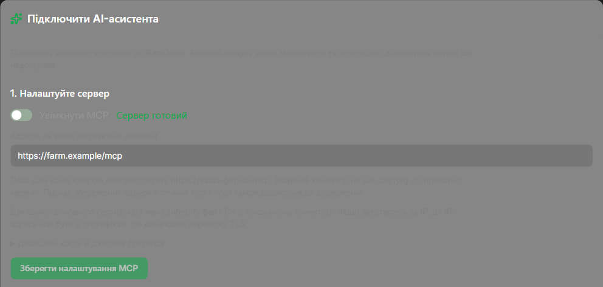

# Підключення асистента

Спершу перевірте [стан розробки й матрицю підтримки](clients.md). Для цих кроків потрібна збірка з панеллю MCP та відповідними пакетами.

## 1. Відкрийте майстер

У BamDude відкрийте **Налаштування → API-ключі → Підключити AI-асистента**. Потрібне право читати налаштування. Для збереження конфігурації потрібне право змінювати налаштування, для створення чи перевірки ключів — відповідні права керування ключами. Якщо дія недоступна, зверніться до адміністратора, а не позичайте його ключ.



*Попередня версія з тестовими даними; живої ферми чи справжнього ключа на знімку немає.*

## 2. Збережіть адресу сервера { #server-address }

Увімкніть MCP і введіть точну адресу, за якою звертатиметься **клієнт**, наприклад `https://farm.example/mcp`. Натисніть **Зберегти налаштування MCP**. Точний хост і порт цієї адреси також додаються до дозволених. Панель не виводить публічну адресу із заголовків запиту браузера.

HTTP на тому самому комп’ютері працює без додаткового дозволу: `http://127.0.0.1:8000/mcp`. З іншого комп’ютера рекомендовано HTTPS. `localhost` означає комп’ютер, який робить запит, а не автоматично сервер ферми.

BamDude також може використовувати незашифровану адресу у приватній мережі під вашим контролем. Увімкніть **Дозволити незашифровані HTTP-адреси для MCP**, прийміть обидва попередження й позначте згоду з ризиком мережі, введіть точну HTTP-адресу та натисніть **Зберегти налаштування MCP**. Ключі API й діагностичні дані передаються відкритим текстом; ніколи не використовуйте цю опцію в публічній мережі чи для адреси з доступом з Інтернету.

Локальний конектор має окреме налаштування **Allow unencrypted HTTP** (`BAMDUDE_MCP_ALLOW_HTTP=true` для ручного налаштування адаптера); якщо його немає, встановіть відповідний оновлений пакет. Прямі клієнти використовують HTTP-адресу без цього прапорця адаптера. Це не вмикає MCP, не розширює права ключів, не змінює перевірки Host/Origin, не налаштовує фаєрвол і не відкриває приватну ферму хмарному клієнту. Перевірка сертифікатів HTTPS зберігається. Для повернення до HTTPS збережіть HTTPS-адресу з вимкненим дозволом HTTP, оновіть адресу клієнта й вимкніть його опцію HTTP. Вимкнення перемикача сервера в UI очищує HTTP-адресу; перед збереженням введіть заміну HTTPS.

У **Дозволених хостах і джерелах браузера** додавайте інші точні хости й порти лише за потреби. Для локальних клієнтів джерела браузера зазвичай порожні. Якщо клієнт надсилає Origin, додайте його точне значення `https://хост:порт`. Не використовуйте шаблони чи джерело `null`.

Для самопідписаного сертифіката в LAN локальний конектор приймає явно вибраний PEM **файл CA**. Сертифікат має відповідати адресі: для звернення за IP ця IP-адреса повинна бути в subject alternative names. Не вимикайте перевірку TLS. Див. [усунення проблем сертифіката](troubleshooting.md).

## 3. Виберіть і встановіть пакет

Виберіть клієнт і виконайте [інструкції для нього](clients.md). Кнопка **Завантажити пакет клієнта** доступна лише тоді, коли збірка має пакет відповідної версії сервера, контрактів і канонічного skill. **Завантажити skill** лишається окремою можливістю.

Не перейменовуйте ZIP на MCPB й не очікуйте, що один пакет працюватиме скрізь. Для Claude Desktop потрібні конектор та окремо встановлений skill. Переносний плагін надає skill, а його MCP-з’єднання налаштовується окремо.

## 4. Створіть окремий ключ

Дайте ключу впізнавану назву. Виберіть принтери для читання або явно позначте **Усі принтери, зокрема додані в майбутньому**. Пресет діагностики вмикає читання стану та MCP, а дії й доступ до логів лишає вимкненими. Не вмикайте логи, якщо вони не потрібні для розслідування або власних прав на них немає.

Натисніть **Створити ключ діагностики**. Скопіюйте його, поки він показаний: відновити значення пізніше не можна. Введіть ключ у захищених налаштуваннях клієнта, ніколи не в чаті, URL чи завантаженому пакеті. Після копіювання закрийте одноразовий показ. Якщо ключ загублено або розкрито, відкличте його й створіть інший.

## 5. Перевірте з асистента

Попросіть обраного асистента:

> Прочитай можливості BamDude, потім його інструкцію. Скажи, які модулі справді доступні.

У Settings виберіть цей ключ і натисніть **Перевірити підключення**. **MCP-запит спостережено** доводить, що цей процес сервера отримав авторизоване MCP-звернення цим ключем. Саме **Сервер готовий** ще не означає підключення клієнта. REST-звернення ключем і завантаження пакета — також не доказ. Після перезапуску сервера позначка скидається.

Позначайте **Я встановив skill у цьому клієнті** лише після встановлення в ньому. Це ваше ручне підтвердження; BamDude не робить такого висновку з MCP-запиту.

## Оновлення, заміна ключа й від’єднання

Після оновлення BamDude завантажте відповідний ZIP клієнта. Для **локального встановлення Codex або Claude Code** виконайте ці кроки (перевірено на Windows із Codex CLI 0.166.0 та Claude Code 2.1.314):

1. Закрийте клієнт і його MCP-підключення. Збережіть попередню розпаковану теку як резервну копію.
2. Розпакуйте новий ZIP до чистої теки за **тим самим постійним шляхом**, який реєстрували раніше. Замініть вміст повністю: не зливайте файли зі старою текою й не створюйте зайвий вкладений каталог.
3. Виконайте команди свого клієнта:

    **Codex CLI**

    ```powershell
    codex plugin add bamdude-ai@bamdude-ai-local
    codex plugin list --json
    ```

    **Claude Code**

    ```powershell
    claude plugin update bamdude-ai@bamdude-ai-local
    claude plugin list --json
    ```

4. Перевірте, що встановлена версія відповідає новому пакету. Почніть **нову сесію клієнта**: стара може тримати попередній skill. Перевірте налаштування ключа й CA, потім знову попросіть capabilities та інструкцію.

`codex plugin marketplace upgrade` оновлює Git-каталоги; для цього локального ZIP це не команда оновлення. Якщо переносите постійну теку, зареєструйте новий шлях за [кроками встановлення](clients.md). Заміна пакета не замінює й не відкликає ключ. Встановлення Claude Desktop окремо перевірено на Windows, але його оновлення лишається [неперевіреним](clients.md); доказ оновлення CLI на нього не поширюється. Якщо контракти несумісні, оновіть сервер і пакет разом; не обходьте перевірку.

Для заміни ключа створіть новий, налаштуйте й перевірте його, потім відкличте старий. Для повного від’єднання: **відкликати ключ у BamDude → видалити плагін/конектор у клієнті → за потреби вимкнути MCP**. Саме видалення плагіна не відкликає ключ.
