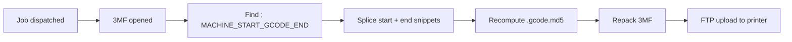

# G-code injection

BamDude can inject **operator-defined G-code snippets** into a print's plate gcode at dispatch time — the start snippet where the printer's start sequence ends, the end snippet after its end sequence. The snippet survives even if BamDude crashes mid-print, runs at exactly the right point in the printer's own gcode sequence (before/after the firmware's reset routines), and is per-printer-model so the same project file can produce a different snippet on an X1C than on a P1S.

This is **not** the same as a [macro](macros.md). Macros are server-driven MQTT pushes at lifecycle events; G-code injection is bytes spliced into the actual file. See the comparison table on the macros page if you're picking between the two.

---

## :material-cog-outline: How it works

1. **Configure** — drop start / end snippets per printer model in **Settings → Printing → G-code Injection**.
2. **Toggle on the print** — when you start a print (PrintModal, queue item, dispatch), tick **Inject G-code**.
3. **Dispatch path** — on every dispatch with the toggle on, the dispatcher reads the snippets for the printer's model from the setting as it is at that moment and opens the 3MF. In the gcode of the **plate being printed** it splices the start snippet just before the `; MACHINE_START_GCODE_END` line (and the end snippet immediately **before** `; EXECUTABLE_BLOCK_END`), recomputes that plate's `.gcode.md5` sidecar, repacks a copy of the 3MF and uploads the copy to the printer via FTP. The other plates and the original file stay as they are.
4. **Audit trail** — the resulting archive's `applied_patches` JSON records `{"name": "gcode_injection", "plate_id": N}`, and its `content_hash` is the hash of the uploaded copy. The archive keeps the original, unpatched file under `source_content_hash`.



---

## :material-pen: Configuring snippets

**Settings → Printing → G-code Injection** auto-discovers every distinct printer model from your linked printers and renders one collapsible `<details>` block per model.

Each model carries two textareas:

| Snippet | Where it splices | Typical use |
|---|---|---|
| **Start G-code** | At the end of the printer's machine start sequence — just before the `; MACHINE_START_GCODE_END` line, once heat-up, homing and bed levelling are done and before the first layer. | Park to a custom origin, set custom acceleration, log start-of-print to a serial probe. |
| **End G-code** | Immediately before `; EXECUTABLE_BLOCK_END` — after the printer's own machine-end sequence, but still inside the block the firmware executes. | Park to back-left for easy retrieval, purge tower clean-cut, post-cool-down nozzle wipe, pause for a manual swap. |

Save on blur — the form auto-prunes empty entries. A "**Configured**" badge on the model summary row appears as soon as at least one of the two textareas has content.

!!! note "Where the end snippet actually lands"
    The end snippet is spliced **immediately before** the `; EXECUTABLE_BLOCK_END` marker, not at the physical end of the file. Bambu firmware (verified on a P1S) ignores any G-code that sits *after* that marker — appending to the file tail silently drops the snippet, so auto-eject / plate-clear moves never fire. Inserting before the marker keeps the snippet inside the block the firmware executes; slicers that don't emit the marker fall back to the old file-tail behaviour.

    Two companion details keep the repacked 3MF valid on picky firmware: the per-plate `.gcode.md5` sidecar is recomputed from the exact patched bytes (a stale hash makes the P1S reject the file at load), and every ZIP member keeps its original compression — `STORE`d members such as the embedded preview PNG aren't re-DEFLATE'd, which the P1S preview parser rejects.

### Placeholder substitution

Snippets support `{name}` placeholders filled from the `; HEADER_BLOCK_START` … `; HEADER_BLOCK_END` block at the top of the plate gcode. Each `; key: value` line there becomes a placeholder: the key is lower-cased, a `[unit]` suffix is dropped and spaces become underscores — `; total layer number: 80` is `{total_layer_number}`, `; max_z_height: 16.00` is `{max_z_height}`, `; total filament weight [g] : 12.3` is `{total_filament_weight}`. Three PrusaSlicer names map to Bambu's: `{max_layer_z}` and `{max_print_height}` to `{max_z_height}`, `{total_layers}` to `{total_layer_number}`.

A placeholder the header doesn't carry stays in the snippet exactly as written, and the server log gets a warning. Only plain names are substituted — there is no arithmetic, so `{max_z_height + 30}` reaches the printer as literal text. Slicer settings such as temperatures are not in this header.

Example:

```gcode
; Lift, park to back-left, nozzle off
G91
G1 Z10 F600          ; 10 mm above where the print ended
G90
G1 X10 Y210 F6000
M104 S0
M117 Done: {total_layer_number} layers, {max_z_height} mm
```

---

## :material-toggle-switch: Per-job toggle

The PrintModal's **Inject G-code** checkbox is the per-job control. It defaults off — turn it on for a specific dispatch when the configured snippet matches what you want for that file. Stays per-`PrintQueueItem` so a queue full of mixed jobs can pick-and-choose.

With the toggle off, or with no snippet configured for the printer's model, the dispatcher takes a fast path that doesn't even open/repack the 3MF. Repacking is only done when there's something to inject — preserves the existing `mesh_mode_fast_check` no-op fast path.

When both **Mesh-mode fast check** and **Inject G-code** are toggled on the same job, the dispatcher does **one** open / patch / repack cycle covering both transforms — large multi-plate 3MFs aren't unzipped twice.

!!! tip "Virtual printers can opt in automatically"
    Prints that arrive through a [virtual printer](virtual-printer.md) don't pass through PrintModal, so each Queue / Auto-queue VP card carries its own **G-code injection** toggle. Turn it on and every job that VP enqueues gets the per-model start/end snippets applied — off by default, a no-op unless snippets exist for the target model, and flipping it restarts the VP.

---

## :material-shield-key: Permissions

| Permission | Grants |
|---|---|
| `settings:update` | Edit the per-model snippet library. |
| `queue:create` / `printers:control` | Toggle Inject G-code on a job (whichever you'd already need to dispatch). |

There's no separate `printers:edit_gcode_snippets` permission — admin gate via `settings:update` is sufficient given the operational nature of this feature (it's writing gcode, not changing auth).

---

## :material-alert-circle-outline: Caveats

!!! warning "Test on a calibration print first"
    Bad start-gcode at the beginning of every print is a recipe for ruined builds. Validate a new snippet on a small calibration cube before letting it apply to your production farm.

- **Marker missing** — if a 3MF doesn't carry `; MACHINE_START_GCODE_END` (rare; some old slicers, custom files), the start snippet falls through to the file head as a best-effort. The end snippet likewise needs `; EXECUTABLE_BLOCK_END`; when that marker is absent it falls back to the file tail.
- **Multi-plate** — only the plate being printed gets the snippets; the other plates in the file are untouched. A plate number the file doesn't have falls back to its first plate. Snippets are per printer model, not per plate (that would need a UI per plate × model and clutters the editor for negligible gain).
- **Reprint of an injected archive** — the archive keeps the original file, never the injected copy, so `Archives → Reprint` with **Inject G-code** on injects the snippets configured at that moment, and with it off prints the file without them.
- **Unreadable setting** — the snippets are read at every dispatch. If the setting can't be read (malformed JSON, a database error), the print goes on without the snippets and the server log gets a warning with the job number and `injection_settings_failed`. Nothing is shown in the interface.

---

## :material-link-variant: Related

- [Macros](macros.md) — server-side MQTT counterpart with a comparison table.
- [Virtual printer](virtual-printer.md) — per-VP toggle that auto-injects these snippets on slicer uploads.
- [Settings reference](../reference/settings.md) — `gcode_snippets` setting JSON shape.
