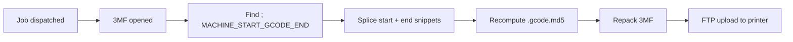

# Інжекція G-code

BamDude вміє вставляти **операторські G-code сніпети** в gcode плити при dispatch'і — start-сніпет туди, де закінчується стартова послідовність принтера, end-сніпет — після його завершальної послідовності. Сніпет переживає падіння BamDude мід-принт, виконується точно в потрібній точці gcode-послідовності принтера (до/після його reset-рутин), і живе на модель принтера — той самий проєкт-файл породить різний сніпет на X1C і P1S.

Це **не те саме**, що [макрос](macros.md). Макроси — server-driven MQTT-пуш на lifecycle-події; G-code injection — байти, вставлені у власне файл. Подивись таблицю порівняння на сторінці макросів, якщо обираєш між ними.

---

## :material-cog-outline: Як це працює

1. **Сконфігуруй** — вкини start / end сніпети на модель в **Settings → Printing → G-code Injection**.
2. **Увімкни на завдання** — при старті друку (PrintModal, queue item, dispatch) постав галочку **Inject G-code**.
3. **Dispatch-шлях** — при кожному dispatch'і з увімкненим тоглером диспатчер читає сніпети для моделі принтера з налаштування таким, яким воно є саме зараз, і відкриває 3MF. У gcode **плити, яка друкується**, він вставляє start-сніпет безпосередньо перед рядком `; MACHINE_START_GCODE_END` (а end-сніпет одразу **перед** `; EXECUTABLE_BLOCK_END`), перераховує `.gcode.md5` сайдкар цієї плити, перепаковує копію 3MF і завантажує копію на принтер по FTP. Інші плити й оригінальний файл лишаються як були.
4. **Аудит** — `applied_patches` JSON архіву записує `{"name": "gcode_injection", "plate_id": N}`, а його `content_hash` — це хеш завантаженої копії. Сам архів зберігає оригінальний, незмінений файл під `source_content_hash`.



---

## :material-pen: Конфігурація сніпетів

**Settings → Printing → G-code Injection** автоматично знаходить кожну унікальну модель принтера зі списку лінкнутих, і малює один collapsible `<details>` блок на модель.

Кожна модель несе дві текстові області:

| Сніпет | Куди вставляється | Типове застосування |
|---|---|---|
| **Start G-code** | Наприкінці стартової послідовності принтера — безпосередньо перед рядком `; MACHINE_START_GCODE_END`, коли нагрів, homing і вирівнювання столу вже позаду, а перший шар ще не почався. | Park у власну точку, виставити кастомну acceleration, лог start-of-print на serial probe. |
| **End G-code** | Одразу перед `; EXECUTABLE_BLOCK_END` — після власної machine-end послідовності принтера, але все ще всередині блоку, який виконує firmware. | Park у back-left для зручного забору, чистий рез purge tower, post-cool-down nozzle wipe, пауза для ручного swap'у. |

Збереження на blur — форма автоматично прибирає порожні entries. Бейдж **Configured** на summary-рядку моделі з'являється, як тільки хоча б одна з двох текстових областей має вміст.

!!! note "Куди насправді лягає end-сніпет"
    End-сніпет вставляється **одразу перед** маркером `; EXECUTABLE_BLOCK_END`, а не в фізичний кінець файлу. Bambu firmware (перевірено на P1S) ігнорує будь-який G-code *після* цього маркера — дописування у хвіст файлу тихо губить сніпет, тож auto-eject / plate-clear рухи ніколи не спрацьовують. Вставка перед маркером тримає сніпет усередині блоку, який виконує firmware; слайсери, що не емітять маркер, падають на старе поводження з хвостом файлу.

    Дві супутні деталі тримають перепакований 3MF валідним на прискіпливому firmware: per-plate `.gcode.md5` сайдкар перераховується з точних пропатчених байтів (застарілий хеш змушує P1S відхилити файл на завантаженні), а кожен ZIP-член зберігає свою оригінальну компресію — `STORE`-члени на кшталт вбудованого preview PNG не re-DEFLATE-яться, що P1S preview-парсер відхиляє.

### Підстановка плейсхолдерів

Сніпети підтримують плейсхолдери `{name}`, які заповнюються з блоку `; HEADER_BLOCK_START` … `; HEADER_BLOCK_END` на початку gcode плити. Кожен рядок `; key: value` у ньому стає плейсхолдером: ключ переводиться в нижній регістр, суфікс `[одиниця]` відкидається, пробіли стають підкресленнями — `; total layer number: 80` дає `{total_layer_number}`, `; max_z_height: 16.00` дає `{max_z_height}`, `; total filament weight [g] : 12.3` дає `{total_filament_weight}`. Три назви PrusaSlicer зіставлено з Bambu: `{max_layer_z}` і `{max_print_height}` — з `{max_z_height}`, `{total_layers}` — з `{total_layer_number}`.

Плейсхолдер, якого в заголовку немає, лишається в сніпеті точно так, як написаний, а в журналі сервера з'являється попередження. Підставляються лише прості назви — арифметики немає, тож `{max_z_height + 30}` дійде до принтера буквальним текстом. Налаштувань слайсера на кшталт температур у цьому заголовку немає.

Приклад:

```gcode
; Підняти, запаркувати в back-left, вимкнути сопло
G91
G1 Z10 F600          ; на 10 мм вище місця, де закінчився друк
G90
G1 X10 Y210 F6000
M104 S0
M117 Done: {total_layer_number} layers, {max_z_height} mm
```

---

## :material-toggle-switch: Тоглер на завдання

Чекбокс **Inject G-code** в PrintModal — це per-job контроль. За замовчуванням off — вмикаєш для конкретного dispatch'у, коли налаштований сніпет підходить файлу. Зберігається на `PrintQueueItem`, тож черга з мікс-jobs може pick-and-choose.

Коли тоглер вимкнено або для моделі принтера не налаштовано жодного сніпета, диспатчер бере fast-path, що навіть не відкриває / не перепаковує 3MF. Repack робиться лише коли є що інжектити — зберігає існуючий `mesh_mode_fast_check` no-op fast-path.

Коли і **Mesh-mode fast check**, і **Inject G-code** увімкнені на тому ж job'і — диспатчер робить **один** open / patch / repack цикл, що покриває обидві трансформації — великі multi-plate 3MF не розпаковуються двічі.

!!! tip "Віртуальні принтери можуть вмикатися автоматично"
    Друки, що приходять через [віртуальний принтер](virtual-printer.uk.md), не проходять через PrintModal, тож кожна картка Queue / Auto-queue VP несе власний тумблер **G-code injection**. Увімкни його — і кожне завдання, яке цей VP ставить у чергу, отримує per-model start/end сніпети. За замовчуванням off, no-op доки нема сніпетів для цільової моделі, а перемикання рестартить VP.

---

## :material-shield-key: Дозволи

| Permission | Що дозволяє |
|---|---|
| `settings:update` | Редагувати бібліотеку сніпетів на моделі. |
| `queue:create` / `printers:control` | Тогглити Inject G-code на job'і (те, що тобі вже потрібно для dispatch'у). |

Окремого `printers:edit_gcode_snippets` permission немає — admin-gate через `settings:update` достатній з огляду на operations-природу фічі (це пишемо gcode, а не міняємо auth).

---

## :material-alert-circle-outline: Підводні камені

!!! warning "Спершу тестуй на калібровці"
    Поганий start-gcode на початку кожного друку — рецепт зіпсованих білдів. Прогон новий сніпет на маленькій калібровці перед тим, як пускати в продакшн ферму.

- **Маркера немає** — якщо 3MF не несе `; MACHINE_START_GCODE_END` (рідкість; деякі старі слайсери, кастомні файли) — start-сніпет валиться у голову файлу як best-effort. End-сніпету так само потрібен `; EXECUTABLE_BLOCK_END`; коли цього маркера нема — він падає у хвіст файлу.
- **Multi-plate** — сніпети отримує лише плита, яка друкується; інші плити файлу не змінюються. Якщо номера плити у файлі немає, сніпети йдуть у його першу плиту. Сніпети задаються на модель принтера, а не на плиту (інакше потрібен UI на плиту × модель, що захаращує редактор без помітної користі).
- **Реприн інжектованого архіву** — архів зберігає оригінальний файл, а не інжектовану копію, тож `Archives → Reprint` з увімкненим **Inject G-code** вставляє сніпети, налаштовані на цей момент, а з вимкненим — друкує файл без них.
- **Нечитабельне налаштування** — сніпети читаються при кожному dispatch'і. Якщо налаштування прочитати не вдається (зламаний JSON, помилка бази даних), друк іде без сніпетів, а в журналі сервера з'являється попередження з номером завдання та `injection_settings_failed`. В інтерфейсі нічого не показується.

---

## :material-link-variant: Дивись також

- [Macros](macros.md) — server-side MQTT-counterpart з таблицею порівняння.
- [Віртуальний принтер](virtual-printer.uk.md) — per-VP тумблер, що авто-інжектить ці сніпети при завантаженнях зі слайсера.
- [Settings reference](../reference/settings.md) — JSON-форма налаштування `gcode_snippets`.
