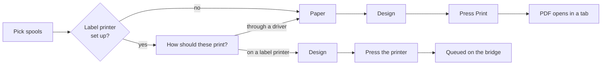

# Spool labels

A spool with a label on it is a spool you can identify from across the room, and one a phone can scan back into BamDude. The layouts are **data, not code** — a label is a list of boxes with millimetre positions, drawn in the browser, stored in the database, and rendered by the server as either a PDF or a one-bit raster for a thermal head.

The editor lives in **Settings → Filament → Marking**. There is no separate page and no menu entry, deliberately: labels belong to the filament you are labelling.

---

## :material-cursor-default-click: Printing a batch

Press **Print labels…** in the header of the Filament page, or tick spools and use the selection toolbar's **Print labels for the selected spools**. The dialog asks three things, in order.



**How should these print?** — only asked when the [label-printer integration](#a-printer-on-your-desk) is switched on *and* a printer has been adopted. With nothing to choose between, the question is not asked at all.

**Paper** — one label per page, or laid out across a sheet of stock. Driver side only: a desk label printer feeds a roll, and there is no page to tile. With a sheet chosen the dialog reminds you to print it at 100 % (actual size), never "Fit to page" — scaling moves every label off its sticker, and it looks exactly like a wrong geometry.

**Starting position** — with a sheet chosen, the first free label on it, counted row by row from the top left. A half-used sheet goes back into the printer: the first page starts at that cell, every later page at the first one.

**Design** — every design drawn for that output, with its description and its size. Press **Print** and the PDF opens in a new tab, where you decide whether to print it or save it.

**Preview** — as soon as a design is chosen, the dialog draws the label of the first selected spool, in the order the batch prints, and with several spools selected the caption says so: *the first of N selected*. It is drawn by the server from that spool's real data. For a print through a driver it is the PDF's own page, in colour (or without the swatch when **Monochrome (black & white printer)** is ticked). When a label cannot be drawn, the place of the picture says *No preview* and why.

!!! tip "A design that does not fit is greyed out, not hidden"
    Pick Avery 5160 and a 40 × 30 mm design stops being selectable, with both measurements in the reason. Labels print at their own size or not at all — shrinking one to fit destroys the bar widths a scanner reads by, and it fails silently: the label looks fine and simply will not scan.

    Whether a design fits is decided in one place, on the server, with one tolerance of 0.5 mm — for a design in a cell, a design on the stock loaded in a desk printer, and a grid on its page. The dialog shows that answer and the print applies the same one, so a design the dialog lets you choose is never refused by the print for its size.

The dialog remembers, in this browser, how the last driver print went out — the paper, the design and the starting position — and opens on them the next time. A remembered sheet or design that has been deleted, or a design that has stopped fitting its paper, is dropped silently.

On the label-printer side there is no **Print** button and no PDF. You pick the design, then press the printer — that *is* the print. A printer whose loaded stock is smaller than the design says so on its own row, because two printers on two desks can have different rolls in them. The preview there is that printer's own picture: the one-bit raster the bridge is handed, for the stock the printer reports. With several printers it shows the first one that can take the design, and names it.

### Saving labels as pictures {#saving-labels-as-pictures}

Next to **Print**, **Save as PNG** writes the same labels as pictures — for the software of a label printer that takes images rather than a PDF. Choose the resolution beside the button: **203 dpi**, **300 dpi** (the default) or **600 dpi**.

- **One picture per label, at its true size.** The picture is the design's millimetres at the chosen resolution, and the PNG records that resolution, so a program that prints it keeps the size.
- **One PNG, or a ZIP.** One selected spool downloads as a single PNG; several download as a ZIP, each file named by the spool's number and name (`0042-polymaker-pla-red.png`).
- **The paper is not part of a picture.** A design chosen together with a sheet is saved label by label, and the starting position does not apply.
- It works the same for local spools and for Spoolman's, and the dialog stays open afterwards — you may still want the PDF.

An export is bounded — see [Limits](#limits). One that is too large is refused before anything is drawn, with a sentence that says what to change, for example *"One export takes at most 200 labels as pictures — select fewer."*

!!! tip "For a thermal printer, prefer the label-printer route or 300 / 600 dpi"
    A saved picture is the colour PDF page turned into dots, so the edges of type, QR modules and barcode bars are smoothed into grey. At 203 dpi — where a module is only a few dots wide — a one-bit thermal head has to turn that grey back into black and white, and the result may not scan. Sending the label [to a desk label printer](#a-printer-on-your-desk) draws it in crisp one-bit dots at the head's own resolution; if you need a picture, save it at 300 or 600 dpi.

---

## :material-pencil-ruler: Drawing a label

**Settings → Filament → Marking** lists your designs on the left and opens one in the editor.

The picture in the middle is **not a drawing of your label — it is your label**. It comes from the same renderer that produces the printed file, filled with example data, so what you are looking at is what comes out. A design printed through a driver is shown in colour, as its PDF page; a design for a label printer is shown as the one-bit picture a thermal head prints, at 8 dots per millimetre.

Each design carries:

| Field | What it does |
|---|---|
| **Name** | Shown in the print dialog and in the editor list. |
| **Description** | One line saying what the label is for, shown under the name wherever the design is offered. |
| **Size** | Width and height in millimetres. This is the label, not the printable area. |
| **Printed on** | `A printer with a driver` or `A label printer` — see [below](#two-kinds-of-label). |

Boxes snap to each other and to the label's own edges and centre, with a red guide showing what they caught on. `Ctrl`/`Cmd` + `Z` undoes, and nothing is written until you press **Save**.

**Duplicate** makes a copy and opens it; **Delete** asks before it removes anything. The designs that come with BamDude are ordinary rows: redraw them, rename them or delete them like your own. Deleting one takes it out of this list and out of the print dialog; an API call that asks for it by its shipped name goes back to the design BamDude ships.

A design has [limits](#limits) — how many boxes, how large, how much type. One that exceeds them is refused with a sentence that names the problem, when you save it, when it is previewed and when it is printed.

### The four kinds of box

| Element | Notes |
|---|---|
| **Text** | Size in mm, bold, italic, horizontal and vertical alignment, and a **fit** rule: `shrink` reduces the size until it fits, `clip` cuts it off, `wrap` continues it on another line. |
| **QR** | Usually `{deeplink}` — scanning it opens the spool in BamDude. New built-in inventory labels also support [assignment by scanning](inventory.md#assign-by-scanning-a-label). |
| **Barcode** | EAN-13, Code 128, Code 39, EAN-8, UPC-A or ITF. EAN-13 takes exactly twelve digits; anything else is reported rather than printed unscannable. |
| **Colour swatch** | A block of the spool's colour, as a rectangle, a circle or a rounded rectangle. One band per colour on a multi-colour spool. |

!!! warning "`shrink` inverts the hierarchy on real data"
    Factory designs keep their authored text size. Where space permits, the spool name gets a second line and the QR and spool number keep their positions. Shrinking makes a long brand name smaller than the short material line beneath it, which reads as the wrong thing being important. That is visible on a render and invisible in a test.

Choose **Wrap** to continue text within its box. PDF and thermal output fit up to three complete lines inside the box, including descenders and italic strokes that extend past the sides of a letter. If the next line would not fit, the last visible line ends with an ellipsis. `shrink` and `clip` keep their single-line behaviour.

### Placeholders

Text and barcode content is written with placeholders in braces — the vocabulary of the spool-name setting on the Inventory page, plus six that exist only on a label. The editor's **Insert a field** list offers every one with an example:

| Placeholder | Field | Example |
|---|---|---|
| `{id}` | DB ID | `42` |
| `{brand}` | Brand | `Polymaker` |
| `{material}` | Material | `PLA` |
| `{subtype}` | Subtype | `Matte` |
| `{color_name}` | Color | `Jade White` |
| `{slicer_filament_name}` | Slicer preset | `Polymaker PolyTerra PLA @Bambu Lab X1C` |
| `{note}` | Note | `Kitchen shelf` |
| `{label_weight_g}` | Label weight (g) | `1000` |
| `{label_weight_kg}` | Label weight (kg) | `1` |
| `{remaining_g}` | Remaining (g) | `750` |
| `{remaining_kg}` | Remaining (kg) | `0.75` |
| `{remaining_pct}` | Remaining (%) | `75%` |
| `{color_hex}` | Color hex | `#FF3300` |
| `{color_hex_all}` | All colour hexes — every colour of a multi-colour spool, comma-separated; what a colour swatch shows | `FF3300,FFFFFF` |
| `{cost_per_kg}` | Cost per kg | `25` |
| `{purchase_date}` | Purchase date | `2026-04-15` |
| `{filament_diameter}` | Filament diameter | `1.75` |
| `{lot}` | Lot | `3` |
| `{material_number}` | Material number | `15` |
| `{display_name}` | Display name — the spool's name under your naming template *(label only)* | `Polymaker PLA Ivory` |
| `{deeplink}` | Deep link — the URL a phone scan opens *(label only)* | `https://bamdude.example/inventory?spool=42&src=local&v=2&key=…` |
| `{ean}` | EAN-13 payload — twelve digits for a barcode *(label only)* | `200000000042` |
| `{storage_location}` | Storage location — the shelf, box or dry cabinet entered for the spool *(label only)* | `Shelf B` |
| `{nozzle_temp}` | Nozzle temperature *(label only)* | `220–240 °C` |
| `{added_date}` | Date added — the day the spool was added to the inventory *(label only)* | `2026-04-15` |

`{nozzle_temp}` is the spool's own range — the minimum and maximum entered on the spool — already written out with its unit. With only one of the two entered it prints that one number, and with neither it prints nothing; the range of a filament family or a slicer preset is never substituted. A placeholder the spool has no value for prints as nothing, and a separator left with nothing on one side of it goes with it — `{brand} · {material}` on a spool without a brand prints `PLA`, not `· PLA`.

A Spoolman spool's label carries the same fields as a local one; the two things Spoolman does not hold — the lot and the purchase date — print empty, and its single extruder temperature is the one number `{nozzle_temp}` shows.

!!! note "An unknown placeholder survives verbatim"
    Type `{lot}` when no such key exists and the label prints the characters `{lot}`. That is deliberate — a typo is visible in the preview rather than silently blank.

### Test print

**Test print** puts the design on real stock through a desk label printer, with the same example data the preview is showing. It is checked against the loaded cassette exactly as a real print is, so a test cannot succeed where the print would refuse.

---

## :material-file-document-multiple: Sheets of stock

A **sheet** is paper: page size, how many cells across and down, the margins and the gaps. It says how big a cell is and **nothing about what goes in one** — printing takes a sheet plus a design that fits the cell. That separation is what lets any label print on any stock.

**Settings → Filament → Marking → Sheets of stickers** holds them. Two Avery layouts ship with BamDude; they are ordinary rows you can correct or delete, and you can draw your own, on A4, A5 or US Letter. **Delete** asks first; deleting a shipped sheet takes it out of the list, and an API call that asks for it by its shipped name goes back to the geometry BamDude ships.

The editor checks the geometry while you type. When you pause, the draft is sent to the server (*Checking the grid…*), and every problem comes back as a sentence under the fields — *"The grid is 215.9mm wide but A4 is 210.0mm — reduce the columns, the cell width, the gap or the left margin."* **Save** is unavailable while a problem is listed, and a save is checked by the same rules. A sheet takes at most 50 cells across and 100 down, a cell is at least 5 mm on each side, and the grid — margin, cells and the gaps between them — has to fit its page, give or take 0.5 mm; the full list is under [Limits](#limits).

**Preview the page** lays a design you already have into every cell, so *does the grid fit the paper* and *does the label fit a cell* are both answered before anything reaches adhesive stock. A grid that runs off its page is refused when you save it, and flagged in the list as **Does not fit the paper** — a geometry can stop fitting without anyone editing it, if the paper under it changes.

!!! tip "Print a sheet at 100 %, never Fit to page"
    The usual reason a sheet drifts off its stickers is not the geometry but the print dialog of the PDF viewer: any scaling moves every label off its sticker. Choose 100 % or *Actual size*.

---

## :material-printer-outline: Two kinds of label

Every design declares where it is going.

| | Through a driver | Label printer |
|---|---|---|
| Output | PDF, printed by your computer | One-bit raster, sent to the device |
| Colour | Yes — it may be landing on an inkjet or a laser | No |
| Colour swatch | Offered | Not offered |
| Sheets | Yes | No — it is a roll |

The split exists because colour cannot survive a one-bit head. A label built around a filled block of the spool's colour does not degrade gracefully on a thermal printer; it arrives missing its subject. So the swatch is simply not offered on a design marked for a label printer, rather than accepted and dropped at print time.

Designs already in your database are all marked `Through a driver`, because that is what every one of them was doing.

---

## :material-printer-eye: A printer on your desk

BamDude renders labels on the server, and a server in a container cannot reach a USB printer on somebody's machine. So it does not try: it renders the label, puts it in a queue, and the **BamDude Bridge** app running on that desktop comes and takes it.

**Settings → Filament → Label printers** holds the switch and the list.

1. **Switch on** *Print labels on printers attached to a desktop*. Nothing is listed until you do.
2. **Start BamDude Bridge** on the computer the printer is plugged into, and switch on its label support. It introduces itself and appears under **Waiting for approval**.
3. **Check the id** shown there against the one the bridge displays in its own window, then enable it. Until you do, that machine cannot take any work.
4. **Give the bridge an API key** with the **Print labels** scope.

Each row shows whether the bridge is answering, whether the *printer* is answering, when it was last seen, and how many labels are queued for it. A cassette barcode teaches BamDude the loaded stock size — until it has, the size gate has nothing to rule on and does not judge.

---

## :material-ruler: Limits {#limits}

A label is small, and the limits are far beyond any real one. They exist so that a mistyped number is answered with a sentence instead of minutes of drawing.

| What | Limit |
|---|---|
| Design size | Up to 500 × 500 mm |
| Elements on a design | Up to 100 |
| One element | Up to 500 mm on a side, and no further than 500 mm from the label |
| Type size | Up to 50 mm |
| All type on a design | The type sizes of its text boxes add up to at most 500 mm (ten lines of 5 mm type are 50) |
| One-bit picture of a design | Up to 4000 dots on a side at the printer's resolution |
| Sheet grid | Up to 50 columns and 100 rows |
| Sheet cell | At least 5 mm on each side |
| Any measurement of a sheet | Up to 2000 mm |
| Fit tolerance | 0.5 mm — a design in a cell, a design on loaded stock, a grid on its page |
| Labels in one PDF | Up to 500 |
| Labels in one **Save as PNG** | Up to 200 |
| Dots in one **Save as PNG** | All pictures together up to 500 megapixels — fifty 100 × 150 mm labels at 600 dpi are 418 |
| One saved picture | Up to 4000 dots on a side — about 169 mm at 600 dpi, 338 mm at 300 dpi |
| One **Save as PNG** download | Up to 64 MB |

Every measurement must be an ordinary number. Whatever is outside a limit is refused in words — when a design or a sheet is saved, previewed, printed or queued for a desk printer — and the sentence says which limit: *"A design takes at most 100 elements."*, *"At 600 dpi these 120 labels come to more than 500 megapixels — select fewer or choose a lower resolution."*

Labels are drawn by workers of their own, apart from the rest of the server, so a large batch does not hold up printers, uploads or the pages you have open. When those workers stay busy and a request has not been drawn within two minutes, it is answered *"Label drawing is busy — try again in a moment"* — repeat it a little later.

---

## :material-shield-key: Permissions

Printing needs less than designing. Whoever may print labels sees the designs and sheets to print them with; drawing them is a separate right.

| Permission | Covers |
|---|---|
| `inventory:read` | Printing labels as a PDF and saving them as PNG — and, for that, the lists of designs and sheets the print dialog offers |
| `label_templates:read` | The editor's side: opening a design, the placeholder list, the design and page previews, the sheet geometry check |
| `label_templates:write` | Creating, editing, duplicating and deleting designs and sheets — the shipped ones included |
| `label_jobs:create` | Sending labels to a desk label printer, its preview in the print dialog, and **Test print** |
| `label_devices:read` | Seeing desk label printers |
| `label_devices:manage` | Adopting and configuring them |
| `label_devices:poll` | What the bridge itself uses — the **Print labels** API-key scope |

---

## :material-api: API

```http
POST /api/v1/inventory/labels
POST /api/v1/spoolman/labels
```

```json
{
  "spools": [{ "id": 12, "display_name": "Polymaker PLA Basic Red" }],
  "template_id": 4,
  "sheet_id": 2,
  "starting_position": 5,
  "monochrome": false
}
```

Returns a PDF stream. Up to 500 labels per request, printed in the order the IDs are sent.

| Field | Meaning |
|---|---|
| `template_id` | A design from the catalogue. |
| `sheet_id` | Paper to lay it out on. On its own — with no `template_id` — it builds a design to fit the cell. |
| `template` | One of six names this endpoint has always accepted, resolved against the designs that ship with BamDude. Cannot be combined with `sheet_id`: two of those names *are* sheets, so that would answer "which paper" twice. |
| `starting_position` | With a sheet: the first free cell, 1-based, row by row (default 1). Refused off a sheet and past the sheet's last cell. |
| `monochrome` | Drops the colour swatch. The hex line still carries the colour. |
| `display_name` | Optional per spool. Omit it and the server composes the same name the Inventory page shows — a label printed by an API key must read like one printed from the browser. |

The designs that ship with BamDude can be redrawn, and an edit reaches these calls too: `{"template": "box_40x30"}` prints the box label as *you* draw it. Deleting the row puts the shipped one back.

### Pictures

```http
POST /api/v1/inventory/labels/png
POST /api/v1/spoolman/labels/png
```

The same body plus `dpi` — `203`, `300` (the default) or `600`. One spool answers `image/png`, several answer `application/zip`. The picture is always one label at the design's own size: a `sheet_id` only chooses the design, and `starting_position` says nothing here. The same `inventory:read` right applies, and the bounds are those under [Limits](#limits) — a request outside them is a `422` with the sentence, a download past 64 MB a `413`.

### Editor calls

| Call | What it answers |
|---|---|
| `POST /api/v1/label-templates/preview` | An unsaved design as a PNG. `colour: true` answers the picture a driver makes — the PDF page, colour block included; without it, the one-bit raster of a thermal head at `dots_per_mm` (default 8). |
| `POST /api/v1/label-templates/sheets/check` | `{"problems": [...]}` for a sheet that is still being typed — every problem as a sentence, always `200`, nothing drawn and nothing saved. |

A draw that cannot be finished within two minutes answers `503` with *"Label drawing is busy — try again in a moment"*.
