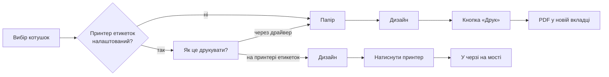

# Наліпки на котушки

Котушка з наліпкою — це котушка, яку впізнаєш через усю кімнату і яку телефон сканує назад у BamDude. Макети тут — це **дані, а не код**: наліпка є списком коробок із координатами в міліметрах, малюється в браузері, лежить у базі, а сервер віддає її або як PDF, або як однобітний растр для термоголовки.

Редактор живе в **Налаштування → Філамент → Маркування**. Окремої сторінки й пункту меню свідомо немає: наліпки належать тому філаменту, який ними маркують.

---

## :material-cursor-default-click: Друк партії

Натисніть **Друк наліпок…** у заголовку сторінки «Філамент» або позначте котушки й скористайтеся кнопкою **Надрукувати наліпки для вибраних котушок** на панелі вибраного. Діалог питає три речі, по черзі.



**Як це друкувати?** — питається тільки тоді, коли [підтримка принтерів етикеток](#a-printer-on-your-desk) увімкнена **і** принтер прийнято. Коли вибирати нема з чого, питання не ставиться взагалі.

**Папір** — по одній наліпці на сторінку або розкладкою на аркуші. Тільки на драйверному шляху: настільний принтер їсть рулон, там немає сторінки, яку можна замостити. Коли вибрано аркуш, діалог нагадує друкувати його в масштабі 100 % (фактичний розмір), а не «Вмістити на сторінку»: масштабування зсуває кожну наліпку з її місця, і виглядає це точнісінько як хибна геометрія.

**Стартова позиція** — коли вибрано аркуш, перша вільна наліпка на ньому, рядок за рядком від лівого верхнього кута. Частково використаний аркуш повертається в принтер: перша сторінка починається з цієї комірки, кожна наступна — з першої.

**Дизайн** — усі дизайни, намальовані для цього способу друку, з описом і розміром. Натискаєте **Друк** — PDF відкривається в новій вкладці, де ви самі вирішуєте: друкувати чи зберегти.

**Перегляд** — щойно вибрано дизайн, діалог малює наліпку першої вибраної котушки — у тому порядку, в якому піде партія, — а коли вибрано кілька котушок, підпис так і каже: *перша з N вибраних*. Малює її сервер зі справжніх даних цієї котушки. Для друку через драйвер це сторінка самого PDF, у кольорі (або без зразка кольору, якщо позначено **Монохромний (чорно-білий принтер)**). Коли наліпку намалювати не можна, на місці картинки написано *Перегляду немає* і чому.

!!! tip "Дизайн, що не влазить, показується неактивним, а не ховається"
    Виберіть Avery 5160 — і дизайн 40 × 30 мм перестає бути доступним, із обома розмірами в поясненні. Наліпка друкується у своєму розмірі або ніяк: стиснути її означає зіпсувати ширину смуг, за якими читає сканер, і збій буде тихим — наліпка виглядає нормально й просто не сканується.

    Чи влазить дизайн, вирішується в одному місці, на сервері, з одним допуском 0,5 мм — для дизайну в комірці, для дизайну на стрічці, зарядженій у настільний принтер, і для сітки на сторінці. Діалог показує цю відповідь, а друк застосовує ту саму, тож дизайн, який діалог дає вибрати, друк ніколи не відхилить через розмір.

Діалог пам'ятає — у цьому браузері, — як пішов останній друк через драйвер: папір, дизайн і стартову позицію, і наступного разу відкривається з ними. Запам'ятаний аркуш чи дизайн, якого вже немає, або дизайн, що перестав влазити у свій папір, мовчки відкидається.

На боці принтера етикеток немає ані кнопки **Друк**, ані PDF. Вибираєте дизайн і натискаєте принтер — це і **є** друк. Принтер, у якому заряджена стрічка менша за дизайн, каже про це у своєму ж рядку: у двох принтерів на двох столах може бути різна стрічка. Перегляд тут — це картинка самого принтера: однобітний растр, який отримає міст, для тієї стрічки, про яку звітує принтер. Коли принтерів кілька, показується перший, що може взяти дизайн, і його названо.

### Збереження наліпок як зображень {#saving-labels-as-pictures}

Поруч із кнопкою **Друк** кнопка **Зберегти як PNG** записує ті самі наліпки зображеннями — для програми принтера етикеток, яка бере картинки, а не PDF. Роздільність вибирається поруч із кнопкою: **203 dpi**, **300 dpi** (типово) або **600 dpi**.

- **Одне зображення на наліпку, у справжньому розмірі.** Зображення — це міліметри дизайну у вибраній роздільності, і PNG записує цю роздільність, тож програма, яка його друкує, зберігає розмір.
- **Один PNG або ZIP.** Одна вибрана котушка завантажується одним PNG; кілька — ZIP-архівом, де кожен файл названо за номером і назвою котушки (`0042-polymaker-pla-red.png`).
- **Папір у зображення не входить.** Дизайн, вибраний разом з аркушем, зберігається наліпка за наліпкою, а стартова позиція не застосовується.
- Працює однаково для локальних котушок і котушок Spoolman, а діалог після цього лишається відкритим — PDF може знадобитися теж.

Експорт має межі — див. [Обмеження](#limits). Завеликий відхиляється ще до малювання, реченням, яке каже, що змінити, — наприклад, що один експорт бере щонайбільше 200 наліпок як зображення.

!!! tip "Для термопринтера краще шлях принтера етикеток або 300 / 600 dpi"
    Збережене зображення — це кольорова сторінка PDF, перетворена на точки, тож краї літер, модулів QR і смуг штрихкоду згладжені в сіре. На 203 dpi, де модуль має лише кілька точок завширшки, однобітна термоголова мусить перетворити це сіре назад на чорне й біле, і результат може не сканувати. Надсилання наліпки [на настільний принтер етикеток](#a-printer-on-your-desk) малює її чіткими однобітними точками у власній роздільності голови; якщо ж потрібне зображення, зберігайте його на 300 або 600 dpi.

---

## :material-pencil-ruler: Малювання наліпки

**Налаштування → Філамент → Маркування** тримає список дизайнів ліворуч і відкриває обраний у редакторі.

Картинка посередині — це **не малюнок вашої наліпки, це ваша наліпка**. Її віддає той самий рендерер, що робить файл на друк, заповнений прикладовими даними, — тож ви дивитесь саме на те, що вийде. Дизайн, що друкується через драйвер, показано в кольорі, як сторінку його PDF; дизайн для принтера етикеток — як однобітну картинку, яку друкує термоголова, на 8 точках на міліметр.

Кожен дизайн має:

| Поле | Що робить |
|---|---|
| **Назва** | Показується в діалозі друку і в списку редактора. |
| **Опис** | Рядок про те, для чого ця наліпка; показується під назвою скрізь, де дизайн пропонується. |
| **Розмір** | Ширина й висота в міліметрах. Це наліпка, а не зона друку. |
| **Друкується на** | `Принтері з драйвером` або `Принтері етикеток` — див. [нижче](#two-kinds-of-label). |

Коробки прилипають одна до одної та до країв і центру самої наліпки, червона лінія показує, за що зачепилось. `Ctrl`/`Cmd` + `Z` скасовує, і нічого не записується, поки не натиснете **Зберегти**.

**Копія** робить копію й відкриває її; **Видалити** спершу питає. Дизайни, що постачаються з BamDude, — звичайні рядки: перемальовуйте, перейменовуйте чи видаляйте їх, як свої. Видалений зникає з цього списку й з діалогу друку; виклик API, що називає його вшитим іменем, повертається до дизайну, з яким постачається BamDude.

Дизайн має [обмеження](#limits) — скільки коробок, якого розміру, скільки тексту. Дизайн, що їх перевищує, відхиляється реченням, яке називає проблему, — під час збереження, перегляду й друку.

### Чотири види коробок

| Елемент | Примітки |
|---|---|
| **Текст** | Розмір у мм, жирний, курсив, вирівнювання по горизонталі й вертикалі, і правило **вміщення**: `shrink` зменшує розмір, поки не влізе, `clip` обрізає, `wrap` переносить текст. |
| **QR** | Зазвичай `{deeplink}` — сканування відкриває рядок цієї котушки в BamDude на телефоні. |
| **Штрихкод** | EAN-13, Code 128, Code 39, EAN-8, UPC-A або ITF. EAN-13 бере рівно дванадцять цифр; про решту вам скажуть, а не надрукують те, що не читається. |
| **Зразок кольору** | Блок кольору котушки — прямокутник, коло або скруглений прямокутник. На багатоколірній котушці — смуга на кожен колір. |

!!! warning "`shrink` перевертає ієрархію на реальних даних"
    У штатних шаблонах зберігається заданий розмір шрифту. Якщо є місце, назва котушки займає другий рядок, а QR і номер котушки залишаються на своїх місцях. Зменшення робить довгу назву бренду дрібнішою за короткий рядок матеріалу під нею — і читається це так, ніби важливе не те. Таке видно оком на рендері й невидиме тесту.

Виберіть **Перенести на наступний рядок**, щоб продовжити текст у межах блока. PDF і термодрук уміщують до трьох повних рядків, враховуючи частини літер під базовою лінією. Якщо наступний рядок не вміщується, останній видимий рядок закінчується трикрапкою. Режими `shrink` і `clip` залишають один рядок.

### Плейсхолдери

Текст і вміст штрихкоду пишуться плейсхолдерами у фігурних дужках — словником налаштування назви котушки на сторінці Інвентарю плюс шість ключів, що існують лише на наліпці. Список **Вставити поле** в редакторі пропонує кожен із прикладом:

| Плейсхолдер | Поле | Приклад |
|---|---|---|
| `{id}` | ID у базі | `42` |
| `{brand}` | Виробник | `Polymaker` |
| `{material}` | Матеріал | `PLA` |
| `{subtype}` | Підтип | `Matte` |
| `{color_name}` | Колір | `Jade White` |
| `{slicer_filament_name}` | Профіль слайсера | `Polymaker PolyTerra PLA @Bambu Lab X1C` |
| `{note}` | Нотатка | `Kitchen shelf` |
| `{label_weight_g}` | Вага за етикеткою (г) | `1000` |
| `{label_weight_kg}` | Вага за етикеткою (кг) | `1` |
| `{remaining_g}` | Залишок (г) | `750` |
| `{remaining_kg}` | Залишок (кг) | `0.75` |
| `{remaining_pct}` | Залишок (%) | `75%` |
| `{color_hex}` | Hex кольору | `#FF3300` |
| `{color_hex_all}` | Усі hex кольорів — усі кольори багатоколірної котушки через кому; те, що показує зразок кольору | `FF3300,FFFFFF` |
| `{cost_per_kg}` | Ціна за кг | `25` |
| `{purchase_date}` | Дата купівлі | `2026-04-15` |
| `{filament_diameter}` | Діаметр філаменту | `1.75` |
| `{lot}` | Лот | `3` |
| `{material_number}` | Номер матеріалу | `15` |
| `{display_name}` | Назва котушки — за вашим шаблоном назв *(лише наліпка)* | `Polymaker PLA Ivory` |
| `{deeplink}` | Посилання — адреса, яку відкриє скан телефоном *(лише наліпка)* | `https://bamdude.example/inventory?spool=42` |
| `{ean}` | Дані EAN-13 — дванадцять цифр для штрихкоду *(лише наліпка)* | `200000000042` |
| `{storage_location}` | Місце зберігання — полиця, коробка чи сушильна шафа, вказані для котушки *(лише наліпка)* | `Shelf B` |
| `{nozzle_temp}` | Температура сопла *(лише наліпка)* | `220–240 °C` |
| `{added_date}` | Дата додавання — день, коли котушку додали до інвентарю *(лише наліпка)* | `2026-04-15` |

`{nozzle_temp}` — це власний діапазон котушки: мінімум і максимум, введені на самій котушці, уже записані з одиницею. Якщо введено лише одне з двох значень, друкується це одне число, якщо жодного — нічого; діапазон сім'ї філаменту чи профілю слайсера ніколи не підставляється. Плейсхолдер, для якого в котушки немає значення, друкується як порожнє місце, а розділювач, що лишився без сусіда з одного боку, зникає разом із ним: `{brand} · {material}` на котушці без виробника надрукує `PLA`, а не `· PLA`.

Наліпка котушки Spoolman несе ті самі поля, що й локальної; дві речі, яких Spoolman не зберігає, — лот і дата купівлі — друкуються порожніми, а його єдина температура екструдера — це те одне число, яке показує `{nozzle_temp}`.

!!! note "Невідомий плейсхолдер виживає дослівно"
    Напишіть `{lot}`, коли такого ключа немає, — і наліпка надрукує символи `{lot}`. Це навмисно: друкарську помилку видно в прев'ю, а не як порожнє місце.

### Тестовий друк

**Тестовий друк** кладе дизайн на реальну стрічку через настільний принтер, із тими самими прикладовими даними, що показує прев'ю. Він перевіряється проти зарядженої касети так само, як справжній друк, — тож тест не може пройти там, де друк відмовить.

---

## :material-file-document-multiple: Аркуші наліпок

**Аркуш** — це папір: розмір сторінки, скільки комірок упоперек і вниз, поля й проміжки. Він каже, якого розміру комірка, і **нічого про те, що в ній буде** — друк бере аркуш плюс дизайн, який у комірку влазить. Саме цей поділ дозволяє друкувати будь-яку наліпку на будь-якому папері.

**Налаштування → Філамент → Маркування → Аркуші наліпок** тримає їх. Два макети Avery йдуть із BamDude; це звичайні рядки, які можна поправити чи видалити, а ще можна намалювати свої — на A4, A5 чи US Letter. **Видалити** спершу питає; видалений вшитий аркуш зникає зі списку, а виклик API, що називає його вшитим іменем, повертається до геометрії, з якою постачається BamDude.

Редактор перевіряє геометрію, поки ви друкуєте. Щойно ви зупиняєтесь, чернетка йде на сервер (*Перевіряємо сітку…*), і кожна проблема повертається реченням під полями — наприклад, що сітка завширшки 215,9 мм, а A4 має 210,0 мм, тож треба зменшити кількість колонок, ширину комірки, проміжок або ліве поле. Кнопка **Зберегти** недоступна, поки в списку є проблема, а збереження перевіряється тими самими правилами. Аркуш бере щонайбільше 50 комірок у ряд і 100 рядів, комірка має щонайменше 5 мм з кожного боку, а сітка — поле, комірки й проміжки між ними — мусить влазити у свою сторінку з допуском 0,5 мм; повний перелік — у розділі [Обмеження](#limits).

**Показати сторінку** розкладає наявний дизайн по всіх комірках, тож і *чи влазить сітка в папір*, і *чи влазить наліпка в комірку* мають відповідь до того, як щось потрапить на клейку основу. Сітку, що виходить за межі сторінки, не дадуть зберегти, і вона позначається в списку як **Не влазить у папір** — геометрія може перестати влазити без жодного редагування, якщо змінити папір під нею.

!!! tip "Друкуйте аркуш у масштабі 100 %, а не «Вмістити на сторінку»"
    Аркуш найчастіше з'їжджає зі своїх наліпок не через геометрію, а через діалог друку у програмі перегляду PDF: будь-яке масштабування зсуває кожну наліпку з її місця. Вибирайте 100 % або *Фактичний розмір*.

---

## :material-printer-outline: Два типи наліпок { #two-kinds-of-label }

Кожен дизайн заявляє, куди він іде.

| | Через драйвер | Принтер етикеток |
|---|---|---|
| Вихід | PDF, який друкує ваш комп'ютер | Однобітний растр, що йде на пристрій |
| Колір | Так — це цілком може бути струменевий чи лазерний | Ні |
| Зразок кольору | Пропонується | Не пропонується |
| Аркуші | Так | Ні — це рулон |

Поділ існує тому, що колір не переживає однобітну голову. Наліпка, побудована навколо залитого кольором блоку, не деградує на термопринтері акуратно — вона приїжджає **без свого предмета**. Тому зразок кольору просто не пропонується на дизайні, позначеному для принтера етикеток, а не приймається й відкидається при друці.

Дизайни, які вже є у вашій базі, усі позначені `Через драйвер`, бо саме це кожен із них і робив.

---

## :material-printer-eye: Принтер на вашому столі { #a-printer-on-your-desk }

BamDude малює наліпки на сервері, а сервер у контейнері не дістане до USB-принтера на чиємусь комп'ютері. Тож він і не пробує: малює наліпку, кладе її в чергу, а застосунок **BamDude Bridge**, що працює на тому комп'ютері, приходить і забирає.

**Налаштування → Філамент → Принтери етикеток** тримає перемикач і список.

1. **Увімкніть** *Друк наліпок на принтерах, підключених до комп'ютера*. Поки цього не зробите, у списку нічого не буде.
2. **Запустіть BamDude Bridge** на комп'ютері, куди підключений принтер, і ввімкніть у ньому підтримку етикеток. Він відрекомендується й з'явиться в розділі **Очікує підтвердження**.
3. **Звірте ідентифікатор** із тим, що міст показує у своєму вікні, і ввімкніть його. Доти ця машина не може взяти жодної роботи.
4. **Видайте мосту API-ключ** із правом **Друк етикеток**.

У кожному рядку видно, чи відповідає міст, чи відповідає **принтер**, коли його бачили востаннє і скільки наліпок для нього в черзі. Штрихкод касети навчає BamDude розміру зарядженої стрічки — доки цього не сталося, розмірному гейту нема про що судити, і він не судить.

---

## :material-ruler: Обмеження {#limits}

Наліпка маленька, і обмеження лежать далеко за межами будь-якої справжньої. Вони існують для того, щоб на помилково введене число відповіддю було речення, а не хвилини малювання.

| Що | Обмеження |
|---|---|
| Розмір дизайну | До 500 × 500 мм |
| Елементів на дизайні | До 100 |
| Один елемент | До 500 мм з боку і не далі ніж 500 мм від наліпки |
| Кегль | До 50 мм |
| Увесь текст дизайну | Кеглі його текстових коробок у сумі — щонайбільше 500 мм (десять рядків кеглем 5 мм — це 50) |
| Однобітна картинка дизайну | До 4000 точок з боку в роздільності принтера |
| Сітка аркуша | До 50 колонок і 100 рядів |
| Комірка аркуша | Щонайменше 5 мм з кожного боку |
| Будь-який розмір аркуша | До 2000 мм |
| Допуск «влазить» | 0,5 мм — дизайн у комірці, дизайн на зарядженій стрічці, сітка на сторінці |
| Наліпок в одному PDF | До 500 |
| Наліпок в одному **Зберегти як PNG** | До 200 |
| Точок в одному **Зберегти як PNG** | Усі зображення разом — до 500 мегапікселів; п'ятдесят наліпок 100 × 150 мм на 600 dpi — це 418 |
| Одне збережене зображення | До 4000 точок з боку — приблизно 169 мм на 600 dpi, 338 мм на 300 dpi |
| Одне завантаження **Зберегти як PNG** | До 64 МБ |

Кожен розмір має бути звичайним числом. Усе, що виходить за обмеження, відхиляється словами — коли дизайн чи аркуш зберігають, переглядають, друкують або ставлять у чергу на настільний принтер, — і речення каже, яке саме обмеження порушено: що дизайн бере щонайбільше 100 елементів, що на 600 dpi вибрані наліпки дають понад 500 мегапікселів і треба вибрати менше або нижчу роздільність.

Наліпки малюють окремі робітники, відділені від решти сервера, тож велика партія не затримує принтери, завантаження чи відкриті сторінки. Коли ці робітники довго зайняті й запит не намальовано за дві хвилини, він отримує відповідь, що малювання наліпок зайняте і слід спробувати трохи згодом, — повторіть його пізніше.

---

## :material-shield-key: Дозволи

Друк потребує менше, ніж малювання. Хто може друкувати наліпки, той бачить дизайни й аркуші, якими їх друкувати; малювати їх — окреме право.

| Дозвіл | Що покриває |
|---|---|
| `inventory:read` | Друк наліпок у PDF і збереження їх як PNG — і, для цього, списки дизайнів та аркушів, які пропонує діалог друку |
| `label_templates:read` | Бік редактора: відкрити дизайн, список плейсхолдерів, перегляд дизайну й сторінки, перевірка геометрії аркуша |
| `label_templates:write` | Створення, редагування, копіювання й видалення дизайнів та аркушів — вшитих теж |
| `label_jobs:create` | Надсилання наліпок на настільний принтер етикеток, його перегляд у діалозі друку і **Тестовий друк** |
| `label_devices:read` | Перегляд настільних принтерів етикеток |
| `label_devices:manage` | Прийняття й налаштування |
| `label_devices:poll` | Те, чим користується сам міст — право API-ключа **Друк етикеток** |

---

## :material-api: API

```http
POST /api/v1/inventory/labels
POST /api/v1/spoolman/labels
```

```json
{
  "spools": [{ "id": 12, "display_name": "Polymaker PLA Basic Red" }],
  "template_id": 4,
  "sheet_id": 2,
  "starting_position": 5,
  "monochrome": false
}
```

Повертає потік PDF. До 500 наліпок за запит, у тому порядку, в якому надіслані ID.

| Поле | Значення |
|---|---|
| `template_id` | Дизайн із каталогу. |
| `sheet_id` | Папір, на якому його розкласти. Сам по собі — без `template_id` — будує дизайн під комірку. |
| `template` | Одне з шести імен, які цей ендпоінт приймав завжди; резолвиться у дизайни, що йдуть із BamDude. Не можна поєднувати з `sheet_id`: два з тих імен **самі є аркушами**, тож це була б відповідь на «який папір» двічі. |
| `starting_position` | З аркушем: перша вільна комірка, з 1, рядок за рядком (типово 1). Без аркуша чи за останньою коміркою — відмова. |
| `monochrome` | Прибирає зразок кольору. Рядок з hex усе одно несе колір. |
| `display_name` | Необов'язково, на кожну котушку. Якщо не передати — сервер складе ту саму назву, яку показує сторінка Інвентарю: наліпка, надрукована по API-ключу, має читатись як надрукована з браузера. |

Дизайни, що йдуть із BamDude, можна перемалювати, і правка доходить і до цих викликів: `{"template": "box_40x30"}` надрукує коробкову наліпку такою, як **ви** її намалювали. Видалення рядка повертає вшитий варіант.

### Зображення

```http
POST /api/v1/inventory/labels/png
POST /api/v1/spoolman/labels/png
```

Те саме тіло плюс `dpi` — `203`, `300` (типово) або `600`. Одна котушка повертає `image/png`, кілька — `application/zip`. Зображення — завжди одна наліпка у власному розмірі дизайну: `sheet_id` лише вибирає дизайн, а `starting_position` тут нічого не означає. Діє те саме право `inventory:read`, а межі — ті, що в розділі [Обмеження](#limits): запит поза ними — це `422` із реченням, завантаження понад 64 МБ — `413`.

### Виклики редактора

| Виклик | Що відповідає |
|---|---|
| `POST /api/v1/label-templates/preview` | Незбережений дизайн як PNG. `colour: true` повертає картинку, яку робить драйвер, — сторінку PDF разом із блоком кольору; без нього — однобітний растр термоголови на `dots_per_mm` (типово 8). |
| `POST /api/v1/label-templates/sheets/check` | `{"problems": [...]}` для аркуша, який ще набирають, — кожна проблема реченням, завжди `200`, нічого не малюється й не зберігається. |

Малювання, яке не вдається завершити за дві хвилини, відповідає `503` — малювання наліпок зайняте, спробуйте трохи згодом.
