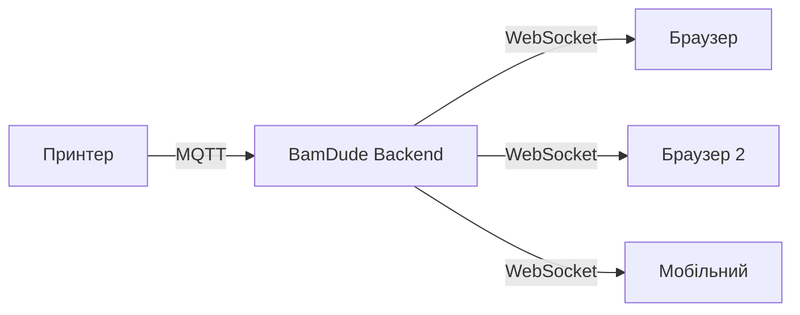

# Моніторинг у реальному часі

BamDude забезпечує живий моніторинг усіх підключених принтерів Bambu Lab через оновлення в реальному часі на базі WebSocket.

!!! tip "Окремий екран оператора"
    Відкрийте [монітор стану](status-monitor.md): однакові плитки, спочатку увага, подання принтерів і черги та ТВ без сесії користувача. Робочі картки нижче залишаються доступними для керування.

---

## :material-resize: Масштабовані картки принтерів

Налаштуйте розмір карток принтерів під ваш екран:

| Розмір | Опис |
|:------:|------|
| **S** | Компактний вигляд, більше карток у рядку |
| **M** | Збалансований вигляд за замовчуванням |
| **L** | Більше деталей, менше карток у рядку |
| **XL** | Максимум деталей, один стовпець |

Використовуйте кнопки **+** і **-** на панелі інструментів для зміни розміру. Вибір зберігається автоматично.

**Картка S теж відповідає на питання «хто завершить першим».** Під смугою прогресу вона несе один рядок метрик, поки триває друк — **час до кінця, ETA й шари** — у тому самому форматуванні, що й картка M, тож обидві читаються однаково. Кожне значення окремо опускається, якщо принтер його не повідомляє, а рядок тримає свою висоту, коли друку немає, — щоб картки не стрибали на старті й завершенні друків.

---

## :material-chart-bar: Панель статусу

Панель статусу вгорі дає швидкий огляд вашого парку:

- :material-circle:{ style="color: #4caf50" } **X доступно** -- Вільні принтери, готові до роботи
- :material-circle:{ style="color: #4caf50" } **X друкують** -- Принтери, що зараз працюють (пульсуюча точка)
- :material-circle:{ style="color: #9e9e9e" } **X офлайн** -- Відключені принтери
- :material-circle:{ style="color: #f44336" } **X проблема** -- Принтери з активними помилками HMS

Коли принтери активні, панель показує, який принтер завершить першим, з індикатором прогресу та часом, що залишився.

---

## :material-monitor-dashboard: Статус принтера

Кожна картка принтера відображає інформацію в реальному часі:

### Показники температури

| Сенсор | Опис |
|--------|------|
| :material-printer-3d-nozzle: **Сопло** | Поточна температура хотенда |
| :material-radiator: **Стіл** | Температура нагрівального столу |
| :material-home-thermometer: **Камера** | Температура корпусу (якщо доступно) |

!!! tip "Історія нагрівачів (Heater History)"
    Кожен рядок температури має маленьку іконку графіка — клік відкриває вікно **Heater History**. Воно малює трейси сопла, столу і камери (плюс трейс другого сопла на dual-nozzle **H2D**) поверх target-оверлеїв, з показниками current / average / min / max і діапазонами **6h / 24h / 48h / 7d**. Заміри записуються раз на хвилину і зберігаються **30 днів** (налаштовується через `printer_sensor_history_retention_days`), далі авто-пруняться. Доступно Operators і Viewers.

### Прогрес друку

Під час активного друку:

- **Індикатор прогресу** -- Візуальний відсоток завершення
- **Поточний шар** -- Шар X з Y
- **Час, що залишився** -- Розрахунковий час до завершення
- **Використано філаменту** -- Витрачено грамів
- **Наступна пауза** -- Де наступна пауза, додана у слайсері, коли така є попереду — див. [нижче](#next-pause)

### Наступна пауза слайсера { #next-pause }

Друк із паузами, доданими у слайсері, показує, де наступна з них, — рядком з іконкою паузи на картці принтера, у будь-якому розмірі картки:

| Рядок | Коли |
|---|---|
| **Пауза через ~12 хв (шар 48)** | Принтер друкує на **стандартній** швидкості, файл містить позначки часу слайсера, а принтер повідомляє час, що залишився. |
| **Пауза менш ніж за хвилину (шар 48)** | Те саме, протягом останньої хвилини — і коли принтер відстає від оцінки слайсера. |
| **Пауза на шарі 48** | В інших випадках: інший режим швидкості або файл без позначок часу. Відомий лише шар. |

Хвилини — це власний залишок часу принтера мінус час, який за слайсером лишається на момент паузи, тож це **оцінка** — так і сказано в підказці. Час слайсера розрахований на стандартну швидкість; в іншому режимі швидкості принтер перераховує свій залишок часу, і рядок показує лише шар, а не число, за яке ніхто не поручиться.

**Що вважається паузою.** Пауза, додана на шарі в Bambu Studio або OrcaSlicer, — прочитана з власного файла друку для плити, яка друкується. Не враховуються: заміна філаменту, пауза у стартовій послідовності до першого шару та G-code, який BamDude додає до копії, надісланої на принтер ([ін'єкція G-code](gcode-injection.uk.md)), — паузи читаються з файла таким, яким його нарізано. Дві паузи на одному шарі — це одна. Коли паузи досягнуто, рядок переходить до наступної; поки принтер стоїть на шарі паузи, ця пауза вже позаду.

**Коли нічого не показується:**

- попереду в друку немає паузи;
- BamDude ще не має файла цього друку — друк, запущений з екрана принтера чи зі слайсера, показує рядок, щойно його 3MF отримано, і ніколи, якщо 3MF отримати не вдалося;
- плита друкується **по об'єктах** — номери шарів починаються заново для кожного об'єкта, і їх не можна порівняти з лічильником шарів принтера;
- друк на паузі або принтер від'єднаний;
- загальна кількість шарів друку ще не відома;
- після перезапуску BamDude — доки він не розпізнає поточний друк як той, який йому відомий.

API несе ту саму відповідь у полі `next_pause` статусу принтера — `{"layer": 48, "minutes": 12}`, де `minutes` дорівнює `null`, коли відомий лише шар, або `null` цілком, коли показувати нічого.

Щоб дізнаватися про паузу заздалегідь, підпишись на сповіщення [Наближається пауза](notifications.uk.md#pause-coming-up).

### Статус підключення

| Індикатор | Значення |
|:---------:|----------|
| :material-circle:{ style="color: #4caf50" } | Зʼєднано і живе |
| :material-circle:{ style="color: #ff9800" } | Підключається / переконнект |
| :material-circle:{ style="color: #f44336" } | Disconnect або помилка |

### Деталі сопла (H2 series)

H2-принтери відкривають розширені дані сопла на ховері:

| Принтер | Картка | Що бачимо |
|---------|--------|-----------|
| **H2D / H2D Pro** | Hover L/R | Поряд деталі обох сопел — діаметр, тип, flow, знос, напрацювання й кількість перемикань (якщо прошивка їх повідомляє), max-temp, серійник. Активне сопло підсвічується **Active** vs **Idle**. |
| **H2S** | Single-nozzle hover | Знос, серійник, max-temp на ховері над температурною плиткою сопла. |
| **H2C** | Nozzle rack | 6-позиційний док tool-changer-а — кожен слот з діаметром і кольором філаменту, а під ним номер позиції 1–6 (ті самі **R1**–**R6**, що у виборі позиції в діалозі друку). Порожні — placeholder і зберігають свій номер; на ховері — повна інформація, зокрема скільки сопло надрукувало і скільки разів його ставили в роботу, якщо прошивка це повідомляє. Картка займає лише ту ширину, якої потребують шість слотів. |

!!! info "L/R семантика — Active vs mounted"
    L/R-картка показує сопло, яким принтер **зараз працює**, а не яке змонтоване. У dual-extruder-друках, де swap відбувається посеред друку, підсвітка йде за live-станом.

### Статус вентиляторів

Live-швидкість вентиляторів у секції Controls:

| Вентилятор | Іконка | Колір | Опис |
|------------|:------:|:-----:|------|
| **Part Cooling** | :material-fan: | Cyan | Охолоджує надруковані шари |
| **Auxiliary** | :material-weather-windy: | Blue | Циркуляція в камері |
| **Chamber** | :material-air-filter: | Green | Відводить гаряче повітря з корпусу |

Активні вентилятори показують поточну швидкість %; неактивні сіріють на 0%. У тому ж рядку є **бейдж швидкості друку** (:material-gauge:) з поточним speed-пресетом.

#### Другий допоміжний вентилятор (P2S / X2D)

**P2S** (комплект-доповнення) і **X2D** (стоїть із заводу) мають другий допоміжний вентилятор, який ніколи не приходить як звичайне поле швидкості — він існує лише всередині даних повітроводу принтера. Він з'являється власним бейджем зі своєю швидкістю, і **цю швидкість можна задати просто з бейджа**.

На машині, де його немає, не з'являється нічого: принтер перелічує лише реально встановлені вузли, тож бейдж керується залізом, а не списком назв моделей.

!!! info "Вентилятори називаються так, як їх називає твій принтер"
    Та сама позиція вентилятора — це не той самий вентилятор на різних моделях: на
    P2S другий допоміжний — **лівий**, на X2D — **правий**, а на X2D він ще й
    називається по-різному в режимах охолодження та нагріву. BamDude бере ці назви
    з визначень принтерів Bambu Studio, які й так поставляє, — тож P2S каже
    **Right Auxiliary Fan**, а не просто «Auxiliary».

Вентилятор, який поточний режим повітроводу тримає вимкненим — наприклад, лівий на P2S у режимі нагріву, — **показується, але не пропонується як контрол**, бо принтер приймає команду й ігнорує її.

### Сенсор дверцят / кришки (тільки X1 Series)

X1 / X1 Carbon / X1E експортують MQTT-сигнал відкритих дверцят (біт 23 у статусі принтера). Коли під час друку принтер репортить, що дверцята відкриті — картка це підсвічує. На інших моделях BamDude не вдає, що сенсор є — у A1, P1, P2 та H2 його просто немає.

### Бейдж AI-детекції збоїв

Коли увімкнена [AI-детекція збоїв Obico](obico.md), кожна картка принтера несе бейдж **AI** поряд з іншими бейджами здоров'я — щоб бачити, як детекція веде поточний друк, не покидаючи сторінку Printers.

| Бейдж | Що означає |
|---|---|
| Сірий | Детекція налаштована, але зараз нічого не спостерігається |
| Зелений | Друк, що спостерігається, класифіковано як **safe** |
| Бурштиновий | **Warning** — оцінка зростає |
| Червоний | **Failure** — налаштована дія спрацювала |

Тултип несе поточну оцінку; клік веде до повного статусу й історії. **Принтер, який детекція не спостерігає, не показує бейджа взагалі**, а не такий, що натякає на покриття.

Бейдж видно кожному, хто бачить принтери, — він **не** вимагає права читати налаштування й свідомо не несе жодної конфігурації: адреса ML-сервера й історія детекції лишаються там, де були.

### Status pip у компактному режимі

У **Small** розмірі картки замість повного бару — один кольоровий pip:

| Колір | Значення |
|:-----:|----------|
| :material-circle:{ style="color: #4caf50" } Зелений | Підключено, без проблем |
| :material-circle:{ style="color: #f44336" } Червоний | Offline, або HMS fatal / serious (severity ≤ 2) |
| :material-circle:{ style="color: #ff9800" } Бурштин | HMS warning (info / common severity) **АБО** друк зараз на паузі |

На ховері — кількість активних HMS-помилок, або resolved причина паузи коли друк на паузі.

### Чіп паузи + live-лічильник тривалості

Коли принтер у стані **PAUSE**, поряд з ім'ям у заголовку картки з'являється inline-pill:

```
Bambu X1C  [⏸ Філамент скінчився · 14m]
```

- **Текст причини** (`pause_reason_label`) — резолвиться сервер-сайд з HMS-стеку принтера через `hms_errors.classify_pause_reason()`. Мапить door-open / filament-runout / AI-detection / presence-check / file-pause-command коди в одну нормалізовану категорію. Внутрішні pause-тригери (наприклад plate-detect auto-pause) плантують hint що бьє HMS, бо Bambu firmware завжди репортить HMS `0300_8001` ("paused by user") на будь-яку pause-команду від BamDude.
- **Live-лічильник тривалості** — тікає щосекунди клієнтсайд проти `pause_started_at` (epoch float у snapshot'і, штампується сервер-сайд на RUNNING→PAUSE edge). Формат: `Ns` до 1 хв → `Nm` до 1 год → `Nh Mm` далі.
- **F5-resilient** — timestamp живе у snapshot'і, не в in-memory state, тож лічильник продовжується з правильної точки після refresh сторінки.

Chip рендериться і в compact (xs), і в expanded (sm) режимах.

### Toast-сповіщення pause / resume

Коли принтер переходить RUNNING→PAUSE або PAUSE→RUNNING, WebSocket доставляє миттєвий browser-toast незалежно від regular polling:

| Edge | Тип toast | Body |
|---|---|---|
| **RUNNING→PAUSE** | warning (жовтий) | `{printer} на паузі: {reason}` — наприклад `Bambu X1C на паузі: Філамент скінчився. Завантаж новий.` |
| **PAUSE→RUNNING** | success (зелений) | `{printer} відновлено (стояв на паузі Nm Ms)` |

Це локальні UI-сповіщення — окремі від налаштованих notification-провайдерів (Telegram / email / Discord / etc.) що шлють відповідні `print_paused` / `print_resumed` події. Дивись [Сповіщення](notifications.uk.md) для конфігурації провайдер-сайду.

### Сортування по статусу + згортувані групи

Якщо сортуєш по **Status**, **Model**, **Location** або **Tag**, картки рендеряться всередині згортуваних секцій — клік на хедер згортає / розгортає групу. Сортування по **Name** залишається плоскою сіткою.

- Стан згорнутості зберігається per-browser у `localStorage`.
- У режимі вибору на хедері кожної секції є **Select All** — виділяє всі картки в групі.
- Status-групи йдуть за пріоритетом: **Error → Printing → Paused → Finished → Idle → Offline**. Перемикач напрямку сортування інвертує порядок.
- Групування за **Tag** показує принтер під **кожним** його тегом; принтери без тегу збираються в «Без тегу». Крапка секції бере колір тегу.
- Кнопка **Теги** в тулбарі звужує сітку до принтерів, що мають **усі** вибрані теги (зберігається, як фільтри статусу й розташування), а пошук матчить і назви тегів.

Сортування **по статусу** в плоскому режимі йде з тим же пріоритетом — все, що потребує уваги, спливає вгору:

1. HMS errors
2. Printing
3. Idle
4. Offline

### Сортування по ETA

П'ятий варіант сортування — **ETA** — впорядковує принтери за тим, як скоро вони завершать: спершу ті, що друкують із відомим залишком часу (найближчі згори — щоб підготувати філамент наступного джоба), далі ті, що щойно стартували ще без ETA, потім idle, потім offline. Читає той самий кешований `remaining_time`, що вже показує per-card ETA-лейбл — без додаткового звернення до бекенда.

### Групування принтерів за локацією

Над сіткою — групування за **локацією**, яку обрано на картці принтера. Зручно, коли ферма розкидана по кімнатах / поверхах — згорни ту, на яку зараз не дивишся.

Локація — це справжня сутність, а не текст, що набирається для кожного принтера окремо: її обирають зі списку, і принтери, датчики та цілі авто-черги вказують на той самий рядок. Саме це не дає `Цех 2` і `цех 2` стати двома різними місцями — а через це елементи авто-черги йшли б у локацію, якої не має жоден принтер, мовчки й назавжди.

Сам список живе в **Settings → Printing → Locations** — власною карткою, під тим правом, яке керує локаціями, а не тим, що дозволяє остаточно видаляти принтер.

!!! note "Списки локацій — за абеткою"
    Скрізь: фільтри на сторінках принтерів, черг і обслуговування, вибір у діалогах
    принтера й авто-черги, список у Settings.

    Порядок — це абетка, а не код символу, за яким Ґ, Є, І та Ї
    йдуть перед А, а все набране в нижньому регістрі падає в самий кінець — тож
    ферма з місцями «Ірпінь» і «Ангар» бачила б щось схоже на відсутність порядку
    взагалі. Нумеровані цехи теж рахуються правильно: **Цех 2** перед
    **Цех 10**, а не після.

### Пошук + фільтри

У тулбарі сторінки Printers:

- **Пошук** — substring-match по імені, моделі, локації, серійнику. Live (Enter не треба).
- **Фільтр статусу** — `All`, `Online`, `Printing`, `Idle`, `Offline`, `Error`.
- **Фільтр локації** — випадайка з локацій, що зараз використовуються.

Фільтри AND-яться; порожній результат показує "Принтерів не знайдено" замість пустої сітки.

### Live-стан з фільтрацією за дозволами

WebSocket-підписки фільтруються на бекенді за дозволами підключеного користувача. Viewer-сесія бачить ті самі live-температури + стан, що й Operator, але не отримує ack-ів виконання макросів, прогресу диспатчу для чужих завдань, чи будь-яких сигналів, прикритих `printers:control`.

---

## :material-alert-decagram: Моніторинг помилок HMS

Система управління здоров'ям (HMS) стежить за станом принтера в реальному часі.

| Статус | Значення |
|:------:|----------|
| :material-check-circle:{ style="color: #4caf50" } **OK** | Проблем не виявлено |
| :material-alert:{ style="color: #ff9800" } **Попередження** | Незначні проблеми |
| :material-alert-circle:{ style="color: #ff5722" } **Помилка** | Серйозні помилки |
| :material-close-circle:{ style="color: #f44336" } **Критично** | Потрібна негайна увага |

Натисніть на індикатор HMS, щоб побачити описи помилок, коди та рекомендовані дії.

Кнопка **Очистити помилки** надсилає команду `clean_print_error` для скидання застарілих помилок без перезавантаження.

### Сповіщення HMS

Збій рівня *Критично* чи *Помилка* надсилається через подію сповіщень `printer_error`:

- **Один раз на появу.** Кожен збій оголошується окремо — два збої на одному вузлі принтера дають два сповіщення.
- **Мерехтіння не повторюється.** Про збій, що зник і повернувся протягом 10 хвилин, вдруге не повідомляється — хіба що між цим змінився стан друку (наприклад, друк відновили) або збою не було 10 хвилин чи довше.
- **Після перезапуску BamDude** повторного сповіщення про вже оголошений збій не буде, якщо принтер і далі його повідомляє. Часткове оновлення стану зберігає запис, доки принтер не надішле дані з джерела збою. Звіт може підтвердити очищення збою, навіть якщо решта картки принтера виглядає так само, зокрема на початку нового друку. Очищення враховується, навіть якщо наступний звіт одразу повертає той самий код.
- **Код — той, що на екрані принтера.** Збій зі списку HMS принтера називається повним кодом із чотирьох груп — `0500-0600-0002-0070` — у заголовку сповіщення та в причині збою завдання черги. `print_error` зберігає коротку форму `XXXX_XXXX`.

### Звідки беруться описи

Описи — власні Bambu, і це весь каталог, близько 5 000 кодів, а не вибірка. Пошук
іде **по моделі принтера**: той самий код може називати різний механізм на різних
машинах — на X2D `0300_401F` каже, що бракує *правого* хотенда, а їх там два.

Помилку без опису все одно показано — з кодом і посиланням на HMS-довідник Bambu,
тож несправність, про яку кричить власний екран
принтера, тут ніколи не лишається невидимою.

Українська — наша: Bambu постачає шістнадцять мов, і української серед них немає,
тож описи перекладаються партіями. Те, що ще не перекладено, показується
англійською, а не порожнім рядком.

### Дії з усунення (remediation)

Діалог HMS-помилки показує ті самі кнопки усунення, що й екран самого принтера — **Resume**, **Stop**, **Ignore & Resume**, "**Filament extruded, continue**", **Stop Drying**, **Turn off Fire Alarm** тощо. Які кнопки з'являться, визначається per model і per error code з каталогу Bambu, тож fault з filament-runout пропонує інші варіанти, ніж fault з температурою камери.

Клік по кнопці — і BamDude надсилає відповідну MQTT-команду, потім чекає, поки принтер реально відреагує, перш ніж підтвердити. QoS-1 publish підтверджується брокером навіть коли firmware мовчки відкидає малформовану HMS-команду, тож BamDude семплить стан принтера через ~2.5 с і репортить помилку, якщо нічого не змінилося. Потрібен `printers:control`; Viewer бачить помилки, але не кнопки.

**Зупинити друк** у цьому діалозі — така сама зупинка людиною, як і з картки принтера: друк закінчується як скасований, а не як невдалий — без сповіщення про невдалий друк, а черга стає на паузу, а не в помилку.

!!! note "Оновлення описів"
    Каталог описів постачається як JSON у `backend/app/data/hms/`, по файлу на
    модель принтера. Перезбери його зі свіжого чекауту BambuStudio командою
    `python scripts/import_hms_catalogue.py`, потім
    `python scripts/translate_hms_catalogue.py --export` збере нові рядки на
    переклад.

!!! note "Оновлення каталогу"
    Каталог дій постачається бандлом як JSON (`data/hms_actions.json`). Коли Bambu додає коди у firmware-апдейті, перегенеруй його: `python scripts/update_hms_actions.py`.

---

## :material-web: Архітектура WebSocket



- **Автоперепідключення** при розриві з'єднання (back-off 3 с)
- **Дельта-оновлення** — надсилаються лише змінені дані
- **Мульти-вкладки** — підтримка кількох вкладок
- **< 1 секунди** — типова затримка
- **Visibility-sync recovery** — коли вкладка повертається з фону, BamDude пінгує WS + інвалідує React-Query, тож stale-дані одразу оновлюються. Тост "Reconnecting…" з'являється тільки після >2 с offline — це гасить мерехтіння на коротких блипах.

## :material-key-variant: Токени для камери

Live MJPEG і знімки приходять у вигляді ``/`<video>` GET-ів, які не можуть нести `Authorization`-хедер. BamDude видає короткоживучий (60 хв) query-param токен з `POST /printers/camera/stream-token`; фронтенд автоматично прошиває його в кожен camera-URL. Мініатюри архіву, обкладинка завдання й інші картинки беруть окремий медіатокен з `POST /auth/media-token`, який отримує кожен залогінений користувач. Токени scoped на залогіненого юзера — login / logout інвалідує кеш, а хук `useStreamTokenSync` обходить DOM і ретрофітить будь-які `` source, рендеренi до того, як токен прийшов. Деталі — на [Сторінці камери](camera.uk.md).

---

## :material-access-point: Сила сигналу WiFi

На картці є гліф WiFi-сили з MQTT-репорта принтера:

| Гліф | Сигнал |
|:----:|--------|
| :material-wifi-strength-4: | Excellent |
| :material-wifi-strength-3: | Good |
| :material-wifi-strength-2: | Fair |
| :material-wifi-strength-1: | Weak |

Слабкий сигнал — найчастіша причина "принтер відвалюється посеред друку" + інтермітентних FTP-помилок. Спочатку чини WiFi, потім полюй на баги диспатчу.

Принтер з Ethernet-портом (X1E, X2D, родина H2), підключений дротом із вимкненим Wi-Fi, показує бейдж **Ethernet** замість гліфа. X1 Carbon, P1S і P2S Ethernet-порту не мають і завжди показують сигнал Wi-Fi.

---

## :material-timer-sand: Загальні години друку

Розгорнута картка показує загальні години друку принтера. Ця цифра — власний лічильник напрацювання принтера плюс поправка годин: та, яку ви задаєте, коли редагуєте загальний час друку машини, що прийшла вже з годинами. Вона не підсумовується з архіву, і саме від неї рахується обслуговування за годинами друку. Лічильник напрацювання росте лише тоді, коли BamDude бачить, що принтер на зв'язку і друкує; час на паузі й поза мережею не рахується — див. [Обслуговування → Типи інтервалів](maintenance.uk.md#типи-інтервалів). Корисно:

- планування обслуговування — у парі з [Maintenance](maintenance.uk.md) ставити роботи (стрижні / сопло / ремінь) на правильні години
- ловити перегружені машини при балансуванні ферми
- post-mortem рано-полеглих принтерів — багато годин зазвичай корелюють з зносом столу / провисом ременя

---

## :material-folder: Файловий браузер принтера

Переглядай і керуй файлами на сховищі принтера прямо з картки — на SD-картці й на вбудованому сховищі тих принтерів, які його мають.

### Як відкрити

Іконка папки (:material-folder:) на картці → модалка проти live-FTPS-сесії.

### Яке сховище ти дивишся

**X2D, P2S і сімейство H2 (H2C, H2D, H2D Pro, H2S)** тримають файли і на картці, і у вбудованому сховищі. На таких принтерах у модалці зʼявляється перемикач **SD-картка / Внутрішнє сховище**, і все нижче працює на обох: перелік, завантаження, прев'ю пластин, Save to Library і видалення.

- Принтер **без вставленої картки** відкривається на внутрішньому сховищі, а не на порожньому списку.
- Принтери, у яких є лише картка — всі A1 і P1 — перемикача **не показують**: картка — їхнє єдине сховище.

!!! note "Чому перемикач не на кожному принтері"
    Внутрішнє сховище доступне другим, власним файловим каналом принтера, яким говорить лише нове покоління. BamDude вирішує за тим, що принтер повідомляє про себе, а не за назвою моделі.

### Навігація

- **Quick-access кнопки** для `Root`, `Cache`, `Models`, `Timelapse` — стрибок на типові шляхи Bambu.
- **Хлібні крихти** з back-step.
- Клік по папці — заглиблення.

**У внутрішньому сховищі структура інша**, і модалка це відображає:

| | SD-картка | Внутрішнє сховище |
|---|---|---|
| Структура | дерево папок | плаский список |
| Шлях / хлібні крихти | так | не показується — заглиблюватись нікуди |
| Quick-access | ярлики папок | **Моделі** і **Таймлапси** — два окремі каталоги, а не дві директорії |
| **Очистити SD** | так | не пропонується |
| Вільне місце | коли принтер повідомляє | не показується — цим каналом принтер його не віддає |

Кнопка **Таймлапси** зʼявляється лише на принтерах, які справді тримають записи всередині. Це окрема здатність від зберігання моделей: машина може вміти одне й не вміти інше.

### Коли теку не вдалося переглянути

Порожня панель — не єдина можлива відповідь: модалка відрізняє порожню теку від тієї, яку принтер не перелічив повністю.

| На панелі | Що сталося |
|---|---|
| **У цій теці немає файлів** | Принтер повністю перелічив теку, і вона порожня. |
| **Цієї теки немає на принтері.** | Принтер відмовив у теці, а тека над нею — перелічена повністю — її не містить. |
| **Принтер відмовився перелічити цю теку.** … | Принтер відмовив у теці, і BamDude не зміг зʼясувати, чи вона існує. |
| **Файлова служба принтера не відповіла, тож цю теку не вдалося переглянути.** … | Немає зʼєднання, передача зірвалась або у відповіді є рядок, який BamDude не зміг прочитати. |
| **Принтер довше, ніж зазвичай, перелічує цю теку.** … | Перелік ще триває. Кнопка оновлення (:material-refresh:) приєднується до нього, а не запускає ще один. |

Жовте попередження вгорі пояснює, чому перелік затримався або не завантажився. Якщо є попередній повний перелік, його вміст лишається під попередженням із приміткою **Показано останній повний перелік цієї теки.** Напис про порожню теку з’являється після того, як повний перелік підтвердить, що файлів немає.

!!! note "Одна передача за раз"
    Файлова служба принтера обслуговує одну сесію за раз, і BamDude надсилає їй по одній: довге завантаження — великий таймлапс, 3MF, який відновлюють, — змушує перелік зачекати, доки воно закінчиться. SD-картка і вбудоване сховище мають кожне свій канал.

### Виділення + bulk-операції

| Дія | Один файл | Кілька |
|-----|-----------|--------|
| **Завантажити** | Сам файл | Один ZIP-архів виділення |
| **Save to Library** | Кладе 3MF як Library-файл (тільки BamDude) — picker папки призначення | Те саме, batch |
| **Видалити** | Confirm + delete | Bulk-delete з confirm |

Шлях **Save to Library** автоматично промоутить голий `.3mf` у `.gcode.3mf`, якщо байти зрізані (probe zip на `Metadata/plate_*.gcode`), щоб теги/парсер Library класифікували коректно.

Клацни прапорець файлу, щоб виділити його. Клік із **Shift** виділяє всі показані файли між останнім клацнутим і цим — у тому порядку й під тим фільтром, що на екрані; файли, сховані фільтром, не потрапляють у виділення. **Select All** і **Deselect All** роблять те саме без клавіатури.

Виділення йде за тим, що каже принтер. Файл зникає з виділення, коли його немає в повному переліку. Поки принтер не відповів — на екрані тоді останній повний перелік — виділення зберігається з позначкою **перелік не підтверджено**, а **Завантажити** спершу просить свіжий перелік, а не діє за старим.

### Завантаження файлів

**Завантажити** не тримає файл у браузері. BamDude готує його на диску сервера, а браузер потім зберігає його як звичайне завантаження, тож тека таймлапсів не мусить уміститися в пам'ять.

Смужка над кнопками показує, що відбувається:

| Смужка каже | Що це означає |
|---|---|
| **Очікуємо вільного місця для завантаження…** | На всьому сервері одночасно готуються два завантаження; ваше наступне. |
| **Готуємо завантаження…** / **Готуємо файл 3 з 12…** | Файли читаються з принтера, показано, скільки вже отримано. **Скасувати** зупиняє. |
| **Зупиняємо завантаження…** | Ви скасували; передавання з принтера зупиняється. **Завантаження скасовано.** з'являється лише тоді, коли воно справді зупинилося. |
| ***назва* готовий** | Браузер почав зберігати файл. **Зберегти** зберігає ще раз; **Відкинути** звільняє місце на сервері. |
| **Не вдалося завантажити *N* з *M* файлів** | Частину файлів принтер не віддав; кожен названо з причиною. **Зберегти решту** забирає архів без них. Нічого не зберігається, доки ви не оберете. |

Якщо не вдалося прочитати жодного файлу, завантаження завершується помилкою й каже про це — порожнього архіву ви не отримаєте.

Вікно можна закрити, поки завантаження готується. BamDude запитає, чи **Продовжити завантаження** у фоні, чи **Скасувати завантаження**; відкрий файловий браузер цього принтера знову, щоб знайти його й зберегти. Завантаження бачить лише той вхід у систему, який його розпочав: в іншому браузері чи після повторного входу його в переліку не буде. Підготовлене завантаження зберігається годину.

Завантаження зупиняється саме, і нічого не видається, коли:

- поки воно готується, у вас забрали доступ до файлів принтера, завершили вашу сесію або деактивували обліковий запис;
- виділення перевищило 10 ГБ або на сервері лишилося б менше резерву вільного місця (5 % тому, щонайменше 512 МБ);
- підготовка триває 45 хвилин;
- відновлюється резервна копія.

Одне завантаження вміщує щонайбільше 1000 файлів — зі сховища, яке ви зараз переглядаєте.

### Файли, які використовує друк

Принтер читає поточне завдання зі свого сховища, тому видалення цього файла обриває друк. BamDude відмовляється видаляти:

- файл поточного друку — який іде, стоїть на паузі або ще готується — і робочі копії, які принтер тримає в `cache`, і на карті, і у вбудованому сховищі;
- файл друку, який BamDude от-от запустить.

Решту файлів під час друку можна видаляти як завжди. Якщо вибрано кілька файлів, кожен отримує власну відповідь: файли, що лишились, названо разом із причиною, і вони лишаються вибраними, а решту видалено.

**Очистити SD-карту** працює лише на принтері, який на звʼязку й простоює, і на якому не починається друк. Якщо друк стартує під час очищення, воно зупиняється і повідомляє, скільки файлів устигло видалити.

З принтера, поточний стан якого BamDude не знає — він відключений або перестав звітувати, — нічого не видаляється. Дочекайтеся відновлення звʼязку і спробуйте ще раз.

### Сортування + фільтр

| Контрол | Опції |
|---------|-------|
| **Sort** | Name (A–Z / Z–A), Size, Date |
| **Filter** | Live substring-match по імені |

### Storage info

Якщо принтер репортить — у хедері модалки видно used / free. Тільки для SD-картки — див. таблицю вище.

### Що BamDude лишає на принтері після друку

Задається на кожен принтер, у його налаштуваннях: **прибирати після друку**. У щойно доданого принтера це **увімкнено**; принтер, доданий до появи налаштування, лишається з тим, що в нього стоїть.

| | SD-картка | Вбудоване сховище |
|---|---|---|
| **Прибирання увімкнено** | Файл, який надіслав BamDude, видаляється, і копія принтера в `cache` теж | Копія, яку тримає принтер, видаляється |
| **Прибирання вимкнено** | Файл переноситься з кореня картки в `cache`, а збережений файл параметрів друку переписується відповідно | Файл лишається рівно там, куди його поклав принтер |

Це прибирання ніколи не видаляє файл, який використовує новіший друк, навіть якщо той запущено зі слайсера чи з екрана принтера під тією самою назвою. На нього є дві хвилини; коли вони минають, поточний крок завершується, а решта лишається на принтері.

Перенесення на картці — це не охайність, а захист. Після зникнення живлення принтер перезапустить те, що лежить у **корені** картки, тож завершене завдання може надрукуватись саме по собі, без нагляду. З вбудованого сховища нічого не автостартує, тож і відсувати нема від чого.

!!! note "Один аплоад — це кілька файлів на машині"
    BamDude надсилає `Cube.3mf`; принтер пише власний `Cube.gcode.3mf` у `cache` на картці і, якщо ввімкнено **зберігати надіслані файли у сховище**, ще й у вбудоване. Прибирання чистить їх усі — і перед видаленням звіряє вміст кожного, бо таку саму назву лишає по собі друк, надісланий напряму з Bambu Studio. Файл, що не збігся, лишається недоторканим.

---

## :material-image-multiple: Зображення принтерів

Кастомізуй картку завантаженням свого фото:

1. Cog на картці.
2. Залий зображення (~300×200 — оптимум).
3. Воно замінить дефолтний hero.

Per-printer; зберігається у бекапах.

---

## :material-bell-ring: Сповіщення про зміну статусу

Підключай будь-яку зі змін стану до notification-каналів:

| Подія | Спрацьовує коли |
|-------|------------------|
| **Printer offline** | MQTT-зʼєднання відвалилось довше за поріг offline |
| **Printer error** | Новий збій HMS рівня «Критично» чи «Помилка» — один раз на появу, див. [Сповіщення HMS](#сповіщення-hms) |
| **Print complete** | Прінт завершився (printed-percentage = 100) |
| **Print failed** | Прінт скінчився non-success-статусом |
| **First layer complete** | Перший шар закінчений (early-fail catch) |
| **Наближається пауза** | Незадовго до [паузи, доданої у слайсері](#next-pause) |

Налаштовується у **Settings → Notifications** — див. [Notifications](notifications.uk.md).

---

## :material-bug: Налагоджувальне логування MQTT

Вбудоване налагодження для комунікації з принтером:

1. Натисніть іконку налаштувань на картці принтера
2. Натисніть **Запустити налагодження MQTT**
3. Перегляньте вхідні/вихідні MQTT-повідомлення з JSON-даними
4. Фільтруйте за типом, шукайте в змісті та автооновлюйте

---

## :material-lightbulb: Поради

!!! tip "Вигляд для ферми"
    Використовуйте маленький розмір карток для моніторингу багатьох принтерів одночасно на великому екрані або планшеті.

!!! tip "Раннє виявлення помилок"
    Увімкніть сповіщення про помилки HMS, щоб виявляти проблеми до того, як вони зіпсують друк.

> Базується на документації [Bambuddy](https://github.com/maziggy/bambuddy).
